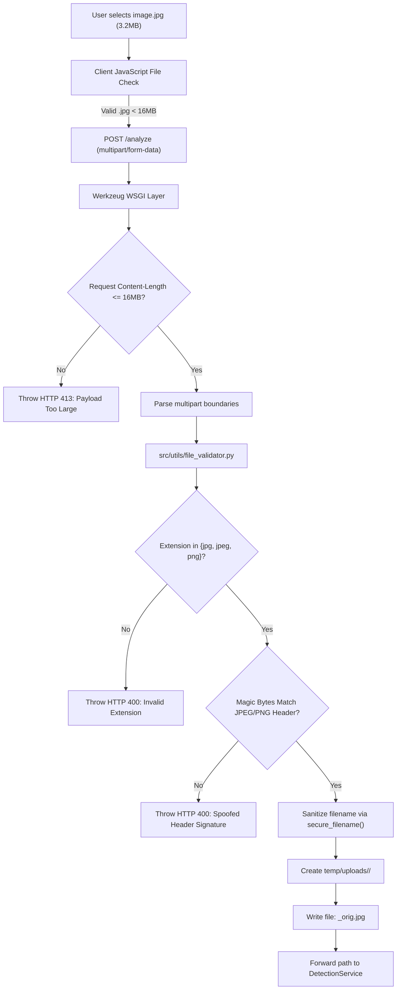

# Image Upload Workflow & Lifecycle Specification

## 1. Upload Processing Pipeline
The upload pipeline provides defense-in-depth across client, WSGI network layer, validation utilities, and ephemeral disk storage.



---

## 2. Directory Layout & Isolation
Every upload request is isolated into an independent session directory:
```
temp/uploads/
└── 7c9e6679-7425-40de-944b-e07fc1f90ae7/
    ├── orig_sample.jpg
    └── ela_sample.png
```
This guarantees zero cross-talk between concurrent user requests and allows atomic directory removal upon completion.
