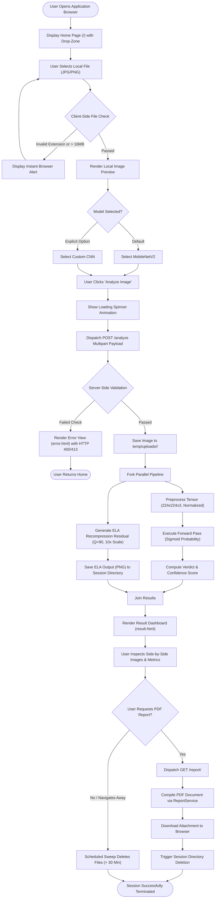

# Activity Diagrams

## 1. Primary User Journey Activity Diagram
This diagram models the entire operational lifecycle from the moment a user accesses the web application through to report download and session disposal.



---

## 2. ELA Generation Activity Detail

```mermaid
flowchart TD
    ELAStart(["Start ELA Generation"]) --> IngestImage["Ingest Source Image File"]
    IngestImage --> ModeCheck{"Is Mode RGB?"}
    ModeCheck -->|No (RGBA/Grayscale)| ConvertRGB["Convert to Standard 3-Channel RGB"]
    ModeCheck -->|Yes| FormatCheck{"Original Format PNG?"}
    ConvertRGB --> FormatCheck
    FormatCheck -->|Yes| LogPNGNotice["Log Forensic Notice: ELA on PNG introduces compression baseline"]
    FormatCheck -->|No| EncodeJPEG["Encode to In-Memory Bytes at JPEG Quality = 90"]
    LogPNGNotice --> EncodeJPEG
    EncodeJPEG --> DecodeJPEG["Decode Recompressed JPEG into Pillow Object"]
    DecodeJPEG --> PixelDiff["Compute Pixel-wise Difference: abs(Original - Recompressed)"]
    PixelDiff --> Scale10x["Multiply Pixel Residues by Enhancement Factor (10x)"]
    Scale10x --> ClipBoundaries["Clip Values to uint8 [0, 255] Range"]
    ClipBoundaries --> OutputPNG["Save High-Contrast ELA Map as PNG"]
    OutputPNG --> ELAEnd(["Return ELA File Path"])
```
