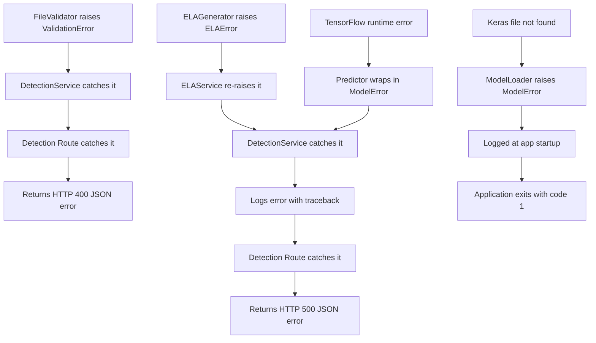

# Component Architecture — Image Manipulation Detection System

> **Document Type:** Detailed Component Specification  
> **Related:** [SYSTEM_ARCHITECTURE.md](./SYSTEM_ARCHITECTURE.md) · [DATA_FLOW.md](./DATA_FLOW.md)  

---

## Table of Contents

1. [Flask Application (app.py + config.py)](#1-flask-application)
2. [Route Layer](#2-route-layer)
3. [Detection Service](#3-detection-service)
4. [File Validator](#4-file-validator)
5. [Image Preprocessing](#5-image-preprocessing)
6. [ELA Generator](#6-ela-generator)
7. [ELA Service](#7-ela-service)
8. [Model Loader](#8-model-loader)
9. [Predictor](#9-predictor)
10. [Custom CNN](#10-custom-cnn)
11. [MobileNetV2 Wrapper](#11-mobilenetv2-wrapper)
12. [Report Service](#12-report-service)
13. [Dataset Loader](#13-dataset-loader)
14. [Dataset Splitter](#14-dataset-splitter)
15. [Dataset Validator](#15-dataset-validator)
16. [Component Interaction Matrix](#16-component-interaction-matrix)
17. [Error Propagation Flow](#17-error-propagation-flow)

---

## 1. Flask Application

**Files:** [`app.py`](file:///media/salman/p5/5th%20sem/ai/Project_ai/Project_semester/image-manipulation-detection/app.py) · [`config.py`](file:///media/salman/p5/5th%20sem/ai/Project_ai/Project_semester/image-manipulation-detection/config.py)

### Purpose
`app.py` implements the Flask **application factory pattern** — it exports a `create_app()` function that constructs and returns a fully configured Flask instance. This design allows the same codebase to produce different application instances for development, testing, and production without modifying source files.

### Inputs
- Environment variable `FLASK_ENV` (selects configuration class)
- Environment variable `SECRET_KEY` (overrides default secret)
- Environment variable `MODEL_TYPE` (`"cnn"` or `"mobilenet"`)

### Outputs
- A configured `Flask` application object ready to serve HTTP requests

### Dependencies
| Dependency | Purpose |
|-----------|---------|
| `flask` | Application, Blueprint, request context |
| `config.py` | `DevelopmentConfig`, `ProductionConfig`, `TestingConfig` |
| `web/main_routes.py` | Home page blueprint |
| `web/detection_routes.py` | Analysis pipeline blueprint |
| `src/utils/logger.py` | Configures root logger at startup |

### Key Functions

```python
def create_app(config_name: str = "development") -> Flask:
    """
    Application factory function.

    Constructs a Flask instance, loads configuration from the config class
    matching `config_name`, registers the main and detection blueprints,
    configures the application logger, and ensures the artifact output
    directories exist on disk.

    Parameters
    ----------
    config_name : str
        One of "development", "production", or "testing".
        Defaults to "development".

    Returns
    -------
    Flask
        A fully configured Flask application instance.

    Raises
    ------
    KeyError
        If `config_name` does not match any registered configuration class.
    """
```

### Configuration Class Hierarchy

```
Config (base)
├── DevelopmentConfig   — DEBUG=True, LOG_LEVEL=DEBUG
├── ProductionConfig    — DEBUG=False, LOG_LEVEL=WARNING
└── TestingConfig       — TESTING=True, reduced upload limit
```

---

## 2. Route Layer

**Files:** [`web/main_routes.py`](file:///media/salman/p5/5th%20sem/ai/Project_ai/Project_semester/image-manipulation-detection/web/main_routes.py) · [`web/detection_routes.py`](file:///media/salman/p5/5th%20sem/ai/Project_ai/Project_semester/image-manipulation-detection/web/detection_routes.py)

### Purpose
Flask Blueprint modules that map HTTP endpoints to handler functions. Routes are **thin** — they only parse requests, call services, and render responses. All business logic lives in the Service layer.

### Inputs
- HTTP requests from the browser (GET parameters, multipart form data, JSON body)

### Outputs
- Rendered HTML templates (Jinja2) or JSON API responses

### Dependencies
| Dependency | Purpose |
|-----------|---------|
| `flask` | `Blueprint`, `request`, `render_template`, `redirect`, `jsonify`, `send_file` |
| `src/services/detection_service.py` | `DetectionService` |
| `src/services/report_service.py` | `ReportService` |
| `src/utils/exceptions.py` | Custom exception types for error handling |

### Endpoint Catalogue

| Method | Endpoint | Handler | Description |
|--------|---------|---------|-------------|
| `GET` | `/` | `main_routes.index` | Renders the home/upload page |
| `GET` | `/about` | `main_routes.about` | Renders the about/documentation page |
| `POST` | `/analyze` | `detection_routes.analyze` | Accepts image upload, runs full pipeline |
| `GET` | `/results/<session_id>` | `detection_routes.results` | Renders stored analysis results |
| `GET` | `/report/<session_id>` | `detection_routes.download_report` | Streams PDF report to browser |
| `GET` | `/ela/<session_id>` | `detection_routes.ela_image` | Serves ELA PNG image for inline display |

### Key Functions

```python
def analyze() -> Response:
    """
    POST /analyze — Main image analysis endpoint.

    Validates that the request contains a file part, delegates to
    DetectionService.analyze(), and renders the results template with
    the prediction, confidence score, ELA image URL, and session ID.

    Returns a JSON error body with HTTP 400 if validation fails, or
    HTTP 500 if an unexpected service error occurs.

    Returns
    -------
    flask.Response
        HTML response with results dashboard on success,
        or JSON error response on failure.
    """

def download_report(session_id: str) -> Response:
    """
    GET /report/<session_id> — On-demand PDF report download.

    Retrieves cached analysis results for `session_id` from the
    application's in-memory session store, calls ReportService to
    compose the PDF, and streams the bytes to the client as an
    attachment.

    Parameters
    ----------
    session_id : str
        UUID string identifying the analysis session.

    Returns
    -------
    flask.Response
        PDF file download response, or HTTP 404 if session not found.
    """
```

---

## 3. Detection Service

**File:** [`src/services/detection_service.py`](file:///media/salman/p5/5th%20sem/ai/Project_ai/Project_semester/image-manipulation-detection/src/services/detection_service.py)

### Purpose
The central **orchestrator** of the image analysis pipeline. `DetectionService` coordinates all sub-modules — validation, preprocessing, model prediction, ELA generation — and returns a unified `AnalysisResult` data structure to the route layer.

### Inputs
| Parameter | Type | Description |
|-----------|------|-------------|
| `file` | `werkzeug.FileStorage` | Raw uploaded file from Flask request |
| `session_id` | `str` | UUID identifying this analysis session |

### Outputs
| Field | Type | Description |
|-------|------|-------------|
| `label` | `str` | `"Authentic"` or `"Tampered"` |
| `confidence` | `float` | Softmax probability for the predicted class (0.0–1.0) |
| `ela_image_path` | `str` | Filesystem path to the generated ELA PNG |
| `ela_image_url` | `str` | URL-safe path for rendering ELA in the browser |
| `model_name` | `str` | Name of the model that produced the prediction |
| `processing_time_ms` | `float` | Total pipeline duration in milliseconds |
| `session_id` | `str` | Echo of the input session identifier |

### Dependencies
| Module | Usage |
|--------|-------|
| `FileValidator` | First gate: rejects invalid files before any I/O |
| `ImageLoader` | Opens uploaded file as PIL Image |
| `ImageResizer` | Resizes to 224 × 224 |
| `ImageNormalizer` | Scales to `[0, 1]` float32 NumPy array |
| `ModelLoader` | Retrieves the cached Keras model |
| `Predictor` | Executes inference and decodes output |
| `ELAService` | Generates and saves the ELA image |
| `Logger` | Structured logging of each pipeline stage |

### Key Functions

```python
class DetectionService:
    def __init__(self, config: Config) -> None:
        """
        Initialises the service by loading the ML model into memory.
        The model is loaded once at construction time and reused across
        all subsequent calls to analyze().

        Parameters
        ----------
        config : Config
            Application configuration object; used to resolve model
            paths and ELA parameters.
        """

    def analyze(self, file: FileStorage, session_id: str) -> AnalysisResult:
        """
        Runs the complete image analysis pipeline for a single upload.

        Pipeline stages (in order):
            1. validate_file()      — rejects unsupported/oversized files
            2. save_temp()          — writes file to artifacts/predictions/uploads/
            3. preprocess()         — load → resize → normalise
            4. predict()            — model inference → (label, confidence)
            5. generate_ela()       — JPEG re-compression difference image
            6. assemble_result()    — builds and returns AnalysisResult

        Parameters
        ----------
        file : werkzeug.FileStorage
            The uploaded image file received from Flask's request.files.
        session_id : str
            UUID string for this analysis session; used to name temp files.

        Returns
        -------
        AnalysisResult
            Dataclass containing label, confidence, ELA path, model name,
            and processing time.

        Raises
        ------
        ValidationError
            If the file fails type, size, or dimension checks.
        ModelError
            If the model is not loaded or inference fails.
        ELAError
            If ELA generation fails (e.g., non-JPEG source image).
        """
```

---

## 4. File Validator

**File:** [`src/utils/file_validator.py`](file:///media/salman/p5/5th%20sem/ai/Project_ai/Project_semester/image-manipulation-detection/src/utils/file_validator.py)

### Purpose
Enforces upload safety constraints before any image processing begins. The validator is the system's **first line of defence** against malformed input, oversized payloads, and unsupported file types.

### Inputs
| Parameter | Type | Description |
|-----------|------|-------------|
| `file` | `werkzeug.FileStorage` | Raw file from Flask request |
| `config` | `Config` | Provides `ALLOWED_EXTENSIONS` and `MAX_CONTENT_LENGTH` |

### Outputs
- Returns `ValidationResult(is_valid: bool, error_message: str | None)`
- Raises `ValidationError` on hard failures (e.g., missing file object)

### Validation Rules

| Rule | Constraint | Error Message |
|------|-----------|---------------|
| File present | `file` must not be `None` and `filename` must not be `""` | "No file selected" |
| Extension | Must be in `{jpg, jpeg, png, bmp, tiff}` | "Unsupported file type: `<ext>`" |
| MIME type | Must start with `image/` | "File does not appear to be an image" |
| Size | Must not exceed 16 MB | "File size exceeds the 16 MB limit" |
| Dimensions | Width and height must each be ≥ 32 px | "Image is too small (minimum 32×32 pixels)" |

### Key Functions

```python
def validate_file(file: FileStorage, config: Config) -> ValidationResult:
    """
    Runs all validation rules against the uploaded file in sequence.

    Checks are ordered from cheapest (filename extension string match)
    to most expensive (reading image dimensions with Pillow). The
    function returns on the first failure rather than collecting all
    errors, to minimise wasted I/O on clearly invalid input.

    Parameters
    ----------
    file : werkzeug.FileStorage
        The uploaded file object from Flask's request.files.
    config : Config
        Application config providing allowed extensions and size limit.

    Returns
    -------
    ValidationResult
        Named tuple with fields is_valid (bool) and error_message (str | None).
        error_message is None when is_valid is True.

    Raises
    ------
    ValidationError
        If `file` is None or its filename attribute is empty.
    """

def _check_extension(filename: str, allowed: set[str]) -> bool:
    """
    Returns True if the lowercase file extension is in the allowed set.
    Uses os.path.splitext to handle multi-dot filenames correctly.
    """

def _check_mime(file: FileStorage) -> bool:
    """
    Reads the MIME type from the FileStorage content_type attribute and
    checks that it begins with 'image/'. Falls back to imghdr.what()
    for files whose MIME type is not reliably set by the browser.
    """

def _check_dimensions(file: FileStorage) -> tuple[int, int]:
    """
    Opens the file with PIL.Image.open() (without fully decoding pixel
    data) and returns its (width, height) tuple. Seeks back to position 0
    after reading so the caller can re-read the file stream.
    """
```

---

## 5. Image Preprocessing

**Files:**  
- [`src/preprocessing/image_loader.py`](file:///media/salman/p5/5th%20sem/ai/Project_ai/Project_semester/image-manipulation-detection/src/preprocessing/image_loader.py)  
- [`src/preprocessing/image_resizer.py`](file:///media/salman/p5/5th%20sem/ai/Project_ai/Project_semester/image-manipulation-detection/src/preprocessing/image_resizer.py)  
- [`src/preprocessing/image_normalizer.py`](file:///media/salman/p5/5th%20sem/ai/Project_ai/Project_semester/image-manipulation-detection/src/preprocessing/image_normalizer.py)

### Purpose
Three-stage preprocessing pipeline that transforms a raw image file from disk into a normalised NumPy array suitable for TensorFlow model input.

### Pipeline Stages

```
File Path (str)
      │
      ▼
  image_loader.py      →   PIL.Image (RGB, arbitrary size)
      │
      ▼
  image_resizer.py     →   PIL.Image (RGB, 224 × 224)
      │
      ▼
  image_normalizer.py  →   np.ndarray (shape: 224×224×3, dtype: float32, range: [0,1])
```

### image_loader.py

```python
def load_image(image_path: str) -> PIL.Image.Image:
    """
    Opens an image from disk and converts it to RGB colour space.

    Handles greyscale (L), RGBA, and palette-mode (P) images by
    converting them to RGB before returning, ensuring a consistent
    3-channel format for downstream processing.

    Parameters
    ----------
    image_path : str
        Absolute or relative path to the image file.

    Returns
    -------
    PIL.Image.Image
        The decoded image in RGB mode.

    Raises
    ------
    FileNotFoundError
        If the path does not point to an existing file.
    PIL.UnidentifiedImageError
        If Pillow cannot parse the file as a known image format.
    """
```

### image_resizer.py

```python
def resize_image(image: PIL.Image.Image, target_size: tuple[int, int] = (224, 224)) -> PIL.Image.Image:
    """
    Resizes an image to the specified target dimensions using Lanczos
    (high-quality downsampling) resampling filter.

    The function does NOT preserve aspect ratio — it stretches or
    squishes the image to fit the target size exactly. This is consistent
    with standard CNN input conventions where the model expects a fixed
    input tensor shape.

    Parameters
    ----------
    image : PIL.Image.Image
        Source image (any size, RGB mode expected).
    target_size : tuple[int, int]
        Target (width, height) in pixels. Defaults to (224, 224).

    Returns
    -------
    PIL.Image.Image
        Resized image in the same mode as the input.
    """
```

### image_normalizer.py

```python
def normalize_image(image: PIL.Image.Image) -> np.ndarray:
    """
    Converts a PIL Image to a float32 NumPy array and scales pixel
    values from the [0, 255] integer range to [0.0, 1.0].

    The returned array has shape (height, width, 3) suitable for a
    single un-batched TensorFlow model input. Callers must add the
    batch dimension with np.expand_dims(..., axis=0) before calling
    model.predict().

    Parameters
    ----------
    image : PIL.Image.Image
        Input image, expected to be in RGB mode and 224×224 pixels.

    Returns
    -------
    np.ndarray
        Float32 array of shape (224, 224, 3) with values in [0.0, 1.0].
    """

def add_batch_dimension(array: np.ndarray) -> np.ndarray:
    """
    Adds a leading batch axis to a 3-D image array.

    Equivalent to np.expand_dims(array, axis=0).

    Parameters
    ----------
    array : np.ndarray
        Image array of shape (H, W, C).

    Returns
    -------
    np.ndarray
        Array of shape (1, H, W, C).
    """
```

---

## 6. ELA Generator

**File:** [`src/preprocessing/ela_generator.py`](file:///media/salman/p5/5th%20sem/ai/Project_ai/Project_semester/image-manipulation-detection/src/preprocessing/ela_generator.py)

### Purpose
Implements the **Error Level Analysis (ELA)** algorithm, a forensic technique that exploits JPEG compression's block-based artefacts to highlight tampered regions. Areas of an image that have been edited and re-saved at a different quality level tend to show distinctly different error levels from the surrounding authentic content.

### Algorithm Description

1. **Load** the original image with Pillow.
2. **Re-compress** the image to a temporary in-memory buffer at a fixed quality (default: 90%).
3. **Reload** the re-compressed version.
4. **Subtract** the re-compressed pixel values from the original pixel values, channel-by-channel.
5. **Amplify** the absolute differences by a scale factor (default: 15×) to make subtle variations visible.
6. **Save** the resulting difference image as a PNG.

### Inputs
| Parameter | Type | Description |
|-----------|------|-------------|
| `image_path` | `str` | Path to the original uploaded image |
| `quality` | `int` | JPEG re-compression quality (0–100, default 90) |
| `amplifier` | `int` | Pixel difference scale factor (default 15) |
| `output_path` | `str` | Where to save the ELA PNG result |

### Outputs
- ELA PNG image saved at `output_path`
- Returns `output_path` as a string on success

### Key Functions

```python
def generate_ela(
    image_path: str,
    quality: int = 90,
    amplifier: int = 15,
    output_path: str | None = None,
) -> str:
    """
    Generates an Error Level Analysis image for the given source image.

    The ELA image visually encodes compression error magnitudes as pixel
    brightness values: bright regions indicate areas with high error levels
    (consistent with manipulation), while dark regions indicate stable areas
    (consistent with original content).

    Parameters
    ----------
    image_path : str
        Path to the uploaded source image. Must be a valid JPEG or PNG.
        PNG images are converted to JPEG internally before ELA analysis.
    quality : int
        JPEG re-save quality factor (0–100). Lower values produce stronger
        compression artefacts, making ELA analysis more sensitive but also
        noisier. Default is 90.
    amplifier : int
        Multiplicative factor applied to each absolute pixel difference.
        Higher values increase ELA image contrast; values above 20 may
        saturate highlights. Default is 15.
    output_path : str | None
        Destination path for the ELA PNG output. If None, the output is
        saved adjacent to the source file with a '_ela.png' suffix.

    Returns
    -------
    str
        The absolute path to the saved ELA image.

    Raises
    ------
    ELAError
        If the source image cannot be opened or re-saved as JPEG, or if
        the difference calculation fails (e.g., shape mismatch).
    FileNotFoundError
        If `image_path` does not exist on disk.
    """

def _recompress(image: PIL.Image.Image, quality: int) -> PIL.Image.Image:
    """
    Re-compresses a PIL Image to JPEG at the specified quality and
    returns the decoded result. Uses an in-memory BytesIO buffer to
    avoid temporary file creation.

    Parameters
    ----------
    image : PIL.Image.Image
        Source image (will be converted to RGB if not already).
    quality : int
        JPEG save quality (0–100).

    Returns
    -------
    PIL.Image.Image
        The decoded re-compressed image.
    """

def _amplify_difference(original: np.ndarray, recompressed: np.ndarray, amplifier: int) -> np.ndarray:
    """
    Computes the absolute pixel-wise difference between two image arrays
    and scales the result by `amplifier`.

    Clips the final array to [0, 255] uint8 range to prevent overflow.

    Parameters
    ----------
    original : np.ndarray
        Original image pixel array, shape (H, W, 3), dtype uint8.
    recompressed : np.ndarray
        Re-compressed image pixel array, same shape and dtype.
    amplifier : int
        Multiplicative scale factor for the difference values.

    Returns
    -------
    np.ndarray
        Amplified difference array, shape (H, W, 3), dtype uint8.
    """
```

---

## 7. ELA Service

**File:** [`src/services/ela_service.py`](file:///media/salman/p5/5th%20sem/ai/Project_ai/Project_semester/image-manipulation-detection/src/services/ela_service.py)

### Purpose
A service-layer wrapper around `ela_generator.py` that handles path management, temp-file naming, and cleanup. Separates the low-level ELA algorithm from the high-level operational concerns of the web service.

### Key Functions

```python
class ELAService:
    def __init__(self, config: Config) -> None:
        """
        Initialises the service with output directory from config.
        Creates the ELA output directory if it does not exist.
        """

    def generate_and_save(self, source_path: str, session_id: str) -> str:
        """
        Generates an ELA image for the given source file and saves it
        to the configured ELA output directory, naming the file using
        the session ID to prevent collisions.

        Parameters
        ----------
        source_path : str
            Absolute path to the original uploaded image.
        session_id : str
            UUID string; used to construct the ELA output filename.

        Returns
        -------
        str
            Absolute path to the saved ELA PNG file.

        Raises
        ------
        ELAError
            Propagated from ela_generator.generate_ela() on failure.
        """

    def cleanup(self, session_id: str) -> None:
        """
        Removes the ELA output file associated with `session_id` from disk.
        Called after the PDF report has been generated or the session expires.
        Silently ignores FileNotFoundError.

        Parameters
        ----------
        session_id : str
            UUID string identifying the files to remove.
        """
```

---

## 8. Model Loader

**File:** [`src/models/model_loader.py`](file:///media/salman/p5/5th%20sem/ai/Project_ai/Project_semester/image-manipulation-detection/src/models/model_loader.py)

### Purpose
Responsible for deserialising a trained Keras model from disk and providing it to the predictor. Implements a **singleton cache** so the model is loaded only once per application lifetime, avoiding repeated disk I/O on every request.

### Key Functions

```python
class ModelLoader:
    _instances: dict[str, tf.keras.Model] = {}

    @classmethod
    def load(cls, model_path: str, model_type: str) -> tf.keras.Model:
        """
        Loads a Keras model from `model_path` and caches it by `model_type`.
        Returns the cached model on subsequent calls without re-loading.

        Parameters
        ----------
        model_path : str
            Path to the .keras or .h5 model file on disk.
        model_type : str
            Logical name key for the cache ("cnn" or "mobilenet").

        Returns
        -------
        tf.keras.Model
            The loaded and compiled Keras model, ready for inference.

        Raises
        ------
        ModelError
            If the file does not exist or cannot be parsed by Keras.
        """

    @classmethod
    def clear_cache(cls) -> None:
        """
        Removes all cached model instances. Primarily used in test teardown
        to ensure a clean state between test cases.
        """
```

---

## 9. Predictor

**File:** [`src/models/predictor.py`](file:///media/salman/p5/5th%20sem/ai/Project_ai/Project_semester/image-manipulation-detection/src/models/predictor.py)

### Purpose
Executes a forward pass through the loaded Keras model and decodes the raw softmax output into a human-readable `PredictionResult`.

### Key Functions

```python
class Predictor:
    def __init__(self, model: tf.keras.Model, class_names: list[str]) -> None:
        """
        Parameters
        ----------
        model : tf.keras.Model
            Loaded Keras model (CNN or MobileNetV2).
        class_names : list[str]
            Ordered list of class labels matching the model's output neurons.
            For this system: ["Authentic", "Tampered"].
        """

    def predict(self, image_array: np.ndarray) -> PredictionResult:
        """
        Runs model inference on a preprocessed image array.

        Adds the batch dimension if not already present, calls
        model.predict(), applies np.argmax to find the winning class index,
        and returns both the class name and its softmax probability.

        Parameters
        ----------
        image_array : np.ndarray
            Normalised image array. Accepts shape (224, 224, 3) or
            (1, 224, 224, 3); the batch dimension is added automatically
            if the input is 3-D.

        Returns
        -------
        PredictionResult
            Named tuple with fields:
                label (str)       — "Authentic" or "Tampered"
                confidence (float) — Softmax probability [0.0, 1.0]
                raw_scores (np.ndarray) — Full softmax output vector

        Raises
        ------
        ModelError
            If model.predict() raises any TensorFlow runtime error.
        ValueError
            If the image_array shape is incompatible with the model's
            expected input shape.
        """
```

---

## 10. Custom CNN

**File:** [`src/models/cnn_model.py`](file:///media/salman/p5/5th%20sem/ai/Project_ai/Project_semester/image-manipulation-detection/src/models/cnn_model.py)

### Purpose
Defines a custom Convolutional Neural Network architecture built from scratch using `tf.keras.Sequential`. The network is designed specifically for binary image forgery detection on 224 × 224 RGB inputs.

### Architecture Summary

| Block | Layers | Output Shape |
|-------|--------|-------------|
| Input | — | (224, 224, 3) |
| Block 1 | Conv2D(32, 3×3, ReLU) → BatchNorm → MaxPool(2×2) | (112, 112, 32) |
| Block 2 | Conv2D(64, 3×3, ReLU) → BatchNorm → MaxPool(2×2) | (56, 56, 64) |
| Block 3 | Conv2D(128, 3×3, ReLU) → BatchNorm → MaxPool(2×2) | (28, 28, 128) |
| Block 4 | Conv2D(256, 3×3, ReLU) → BatchNorm → MaxPool(2×2) | (14, 14, 256) |
| Flatten | GlobalAveragePooling2D | (256,) |
| Dense 1 | Dense(512, ReLU) → Dropout(0.5) | (512,) |
| Dense 2 | Dense(256, ReLU) → Dropout(0.3) | (256,) |
| Output | Dense(2, Softmax) | (2,) |

### Key Functions

```python
def build_cnn_model(input_shape: tuple = (224, 224, 3), num_classes: int = 2) -> tf.keras.Model:
    """
    Constructs and compiles the custom CNN model.

    The model uses Adam optimiser with an initial learning rate of 1e-4,
    categorical cross-entropy loss, and accuracy metric.

    Parameters
    ----------
    input_shape : tuple
        Expected input tensor shape (H, W, C). Default (224, 224, 3).
    num_classes : int
        Number of output classes. Default 2 (Authentic, Tampered).

    Returns
    -------
    tf.keras.Model
        Compiled Keras model ready for training or inference.
    """
```

---

## 11. MobileNetV2 Wrapper

**File:** [`src/models/mobilenet_model.py`](file:///media/salman/p5/5th%20sem/ai/Project_ai/Project_semester/image-manipulation-detection/src/models/mobilenet_model.py)

### Purpose
Wraps TensorFlow's pre-trained MobileNetV2 (trained on ImageNet) with a custom binary classification head. The base layers are initially frozen during the first training phase; selective unfreezing is applied for fine-tuning in the second phase.

### Architecture Summary

| Component | Configuration |
|-----------|--------------|
| **Base model** | `tf.keras.applications.MobileNetV2(include_top=False, weights='imagenet')` |
| **Input shape** | (224, 224, 3) |
| **Pooling** | `GlobalAveragePooling2D()` |
| **Head layer 1** | `Dense(256, activation='relu')` + `Dropout(0.5)` |
| **Head layer 2** | `Dense(128, activation='relu')` + `Dropout(0.3)` |
| **Output** | `Dense(2, activation='softmax')` |
| **Phase 1** | Base frozen, head only trained (20 epochs) |
| **Phase 2** | Top 50 base layers unfrozen, fine-tuned with LR=1e-5 |

### Key Functions

```python
def build_mobilenet_model(
    input_shape: tuple = (224, 224, 3),
    num_classes: int = 2,
    freeze_base: bool = True,
) -> tf.keras.Model:
    """
    Builds a transfer-learning model using MobileNetV2 as the backbone.

    Parameters
    ----------
    input_shape : tuple
        Expected model input shape. Must be (224, 224, 3) for MobileNetV2.
    num_classes : int
        Number of output classes. Default 2.
    freeze_base : bool
        If True, all MobileNetV2 base layers are non-trainable. Set to
        False for fine-tuning. Default True.

    Returns
    -------
    tf.keras.Model
        Compiled Keras functional model.
    """

def unfreeze_top_layers(model: tf.keras.Model, n_layers: int = 50) -> tf.keras.Model:
    """
    Unfreezes the top `n_layers` of the MobileNetV2 base for fine-tuning.

    Re-compiles the model with a lower learning rate (1e-5) after
    unfreezing to prevent catastrophic forgetting of ImageNet weights.

    Parameters
    ----------
    model : tf.keras.Model
        The model returned by build_mobilenet_model().
    n_layers : int
        Number of layers from the end of the base model to unfreeze.

    Returns
    -------
    tf.keras.Model
        Re-compiled model with partially unfrozen base.
    """
```

---

## 12. Report Service

**File:** [`src/services/report_service.py`](file:///media/salman/p5/5th%20sem/ai/Project_ai/Project_semester/image-manipulation-detection/src/services/report_service.py)

### Purpose
Composes a structured PDF analysis report from the prediction results, ELA image, and session metadata. The report is generated **on demand** only when the user clicks "Download Report".

### Report Contents

| Section | Content |
|---------|---------|
| Header | Project name, generation timestamp, session ID |
| Image Summary | Original filename, dimensions, file size |
| Prediction | Label (Authentic/Tampered), confidence score, model name |
| ELA Analysis | ELA image embedded as figure with interpretation note |
| Technical Details | Input shape, preprocessing steps, model architecture summary |
| Footer | Disclaimer about automated analysis limitations |

### Key Functions

```python
class ReportService:
    def generate_pdf(self, result: AnalysisResult, output_path: str) -> str:
        """
        Generates a PDF report for the given analysis result and saves it
        to `output_path`.

        Parameters
        ----------
        result : AnalysisResult
            The full analysis result returned by DetectionService.analyze().
        output_path : str
            Destination path for the PDF file.

        Returns
        -------
        str
            Absolute path to the generated PDF file.

        Raises
        ------
        ReportError
            If PDF generation fails (e.g., ELA image file is missing,
            or the output directory is not writable).
        """

    def _embed_ela_image(self, pdf_doc, ela_path: str) -> None:
        """
        Embeds the ELA PNG image into the PDF document at the current
        cursor position, resizing it to fit within the page margins.
        Raises ReportError if the ELA file is not found.
        """
```

---

## 13. Dataset Loader

**File:** [`src/data/dataset_loader.py`](file:///media/salman/p5/5th%20sem/ai/Project_ai/Project_semester/image-manipulation-detection/src/data/dataset_loader.py)

### Purpose
Reads the CASIA dataset directory structure and provides an iterable of `(image_path, label)` tuples for training scripts.

### CASIA Directory Convention

```
data/
└── CASIA2/
    ├── Au/        ← Authentic images  (label: 0)
    └── Tp/        ← Tampered images   (label: 1)
```

### Key Functions

```python
def load_dataset(dataset_root: str) -> list[tuple[str, int]]:
    """
    Scans the Au/ and Tp/ subdirectories of `dataset_root` and returns
    a shuffled list of (image_path, label) tuples.

    Label encoding: 0 = Authentic, 1 = Tampered.

    Parameters
    ----------
    dataset_root : str
        Path to the CASIA dataset root directory (containing Au/ and Tp/).

    Returns
    -------
    list[tuple[str, int]]
        Shuffled list of (absolute_path, integer_label) pairs.

    Raises
    ------
    FileNotFoundError
        If `dataset_root` does not exist or lacks Au/ and Tp/ subdirectories.
    DatasetError
        If fewer than 10 images are found in total (likely a path error).
    """
```

---

## 14. Dataset Splitter

**File:** [`src/data/dataset_splitter.py`](file:///media/salman/p5/5th%20sem/ai/Project_ai/Project_semester/image-manipulation-detection/src/data/dataset_splitter.py)

### Purpose
Splits a loaded dataset into train, validation, and test subsets with configurable ratios, ensuring stratified sampling to maintain label balance across all splits.

### Key Functions

```python
def split_dataset(
    samples: list[tuple[str, int]],
    train_ratio: float = 0.70,
    val_ratio: float = 0.15,
    test_ratio: float = 0.15,
    random_seed: int = 42,
) -> tuple[list, list, list]:
    """
    Splits `samples` into stratified train, validation, and test subsets.

    Uses scikit-learn's train_test_split with stratify=labels to ensure
    each split has approximately the same class distribution as the full
    dataset.

    Parameters
    ----------
    samples : list[tuple[str, int]]
        Full dataset as returned by dataset_loader.load_dataset().
    train_ratio : float
        Fraction of data for training. Default 0.70.
    val_ratio : float
        Fraction of data for validation. Default 0.15.
    test_ratio : float
        Fraction of data for testing. Default 0.15.
        Note: train_ratio + val_ratio + test_ratio must equal 1.0.
    random_seed : int
        Random seed for reproducibility. Default 42.

    Returns
    -------
    tuple[list, list, list]
        (train_samples, val_samples, test_samples) where each is a list
        of (image_path, label) tuples.

    Raises
    ------
    ValueError
        If the ratios do not sum to 1.0 (tolerance: 1e-6).
    """
```

---

## 15. Dataset Validator

**File:** [`src/data/dataset_validator.py`](file:///media/salman/p5/5th%20sem/ai/Project_ai/Project_semester/image-manipulation-detection/src/data/dataset_validator.py)

### Purpose
Performs integrity checks on the dataset before training begins. Detects corrupt image files, extreme class imbalance, and missing directories early.

### Validation Checks

| Check | Threshold | Action on Failure |
|-------|-----------|------------------|
| Directory exists | `Au/` and `Tp/` present | Raise `DatasetError` |
| Minimum samples | ≥ 100 images per class | Raise `DatasetError` |
| Class imbalance | Ratio ≤ 10:1 | Log warning (does not halt) |
| Corrupt files | PIL can open file | Log warning, exclude from dataset |
| Dimension consistency | All images ≥ 32 × 32 | Log warning, exclude from dataset |

### Key Functions

```python
def validate_dataset(dataset_root: str) -> DatasetValidationReport:
    """
    Runs all integrity checks on the dataset at `dataset_root`.

    Parameters
    ----------
    dataset_root : str
        Path to the CASIA dataset root directory.

    Returns
    -------
    DatasetValidationReport
        Dataclass containing:
            is_valid (bool)              — True if no fatal errors found
            total_images (int)           — Total image count across both classes
            authentic_count (int)        — Number of Au/ images
            tampered_count (int)         — Number of Tp/ images
            corrupt_files (list[str])    — List of paths to unreadable files
            warnings (list[str])         — Non-fatal issue descriptions
            errors (list[str])           — Fatal issue descriptions

    Raises
    ------
    DatasetError
        If `dataset_root` does not exist.
    """
```

---

## 16. Component Interaction Matrix

The table below maps each component (row) to the components it **directly calls** (columns). A ✓ indicates a direct dependency; a — indicates no direct interaction.

| Caller \ Callee | FileValidator | ImageLoader | ImageResizer | ImageNormalizer | ELAGenerator | ModelLoader | Predictor | ELAService | ReportService | DatasetLoader | Logger |
|----------------|:---:|:---:|:---:|:---:|:---:|:---:|:---:|:---:|:---:|:---:|:---:|
| **DetectionService** | ✓ | ✓ | ✓ | ✓ | — | ✓ | ✓ | ✓ | — | — | ✓ |
| **DetectionRoutes** | — | — | — | — | — | — | — | — | ✓ | — | ✓ |
| **ELAService** | — | — | — | — | ✓ | — | — | — | — | — | ✓ |
| **ReportService** | — | — | — | — | — | — | — | — | — | — | ✓ |
| **Predictor** | — | — | — | — | — | ✓ | — | — | — | — | ✓ |
| **TrainCNN** | — | ✓ | ✓ | ✓ | — | — | — | — | — | ✓ | ✓ |
| **TrainMobileNet** | — | ✓ | ✓ | ✓ | — | — | — | — | — | ✓ | ✓ |
| **DatasetSplitter** | — | — | — | — | — | — | — | — | — | ✓ | — |
| **DatasetValidator** | — | — | — | — | — | — | — | — | — | ✓ | ✓ |

---

## 17. Error Propagation Flow

The system uses a custom exception hierarchy defined in [`src/utils/exceptions.py`](file:///media/salman/p5/5th%20sem/ai/Project_ai/Project_semester/image-manipulation-detection/src/utils/exceptions.py):

```
BaseAppException
├── ValidationError      — invalid user input (HTTP 400)
├── ModelError           — model loading or inference failure (HTTP 500)
├── ELAError             — ELA generation failure (HTTP 500)
├── ReportError          — PDF report generation failure (HTTP 500)
└── DatasetError         — dataset integrity check failure (training only)
```

### Error Propagation Path



### Error Response Format

All errors from the `/analyze` endpoint return a consistent JSON structure:

```json
{
  "success": false,
  "error": {
    "type": "ValidationError",
    "message": "Unsupported file type: .gif",
    "code": 400
  }
}
```

This format is consumed by the frontend JavaScript to display user-friendly error modals without a full page reload.
