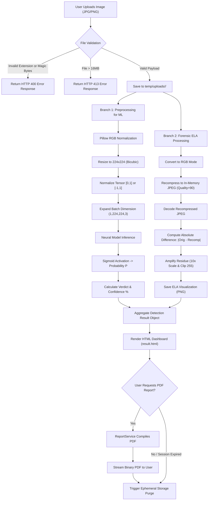

# Data Flow Architecture & Transformation Pipeline

## 1. End-to-End Pipeline Overview
The data flow within the **Image Manipulation Detection System** moves linearly from raw HTTP multipart payloads through defensive validation, dual processing branches (Deep Learning inference and Error Level Analysis), into ephemeral presentation and report generation.

---

## 2. Detailed Data Transformation Stages

| Stage | Input Representation | Output Representation | Library / Tool | Mathematical Operation / Rule |
| :--- | :--- | :--- | :--- | :--- |
| **1. Validation** | Raw bytes stream (`request.files['image']`) | Cleaned file on disk (`temp/uploads/<session_id>/orig.jpg`) | Werkzeug, `file_validator.py` | Verify magic bytes header; sanitize filename |
| **2. Ingestion & Color Cast** | Binary file path | PIL Image (`mode="RGB"`) | Pillow (`PIL.Image`) | Flatten RGBA alpha transparency to white background; convert grayscale |
| **3. Dimensional Rescaling** | Variable size ($W \times H \times 3$) | Standardized tensor ($224 \times 224 \times 3$) | Pillow / OpenCV | Bicubic interpolation |
| **4. Normalization** | Integer array $[0, 255]$ | Float32 tensor $[0.0, 1.0]$ or $[-1.0, 1.0]$ | NumPy / TensorFlow | $x_{\text{norm}} = \frac{x}{255.0}$ (CNN) or $\frac{x}{127.5} - 1.0$ (MobileNetV2) |
| **5. Model Forward Pass** | Shape `(1, 224, 224, 3)` | Scalar probability $P \in [0.0, 1.0]$ | TensorFlow Keras | Feed-forward conv layers + Sigmoid output |
| **6. Verdict Classification** | Probability $P$ | Categorical label + Confidence % | `detection_service.py` | $\text{Label} = \begin{cases} \text{Manipulated}, & P \ge 0.5 \\ \text{Authentic}, & P < 0.5 \end{cases}$ |
| **7. ELA Recompression** | Source image file | In-memory JPEG buffer | Pillow | Save as JPEG at quality factor $Q = 90$ |
| **8. Residual Difference** | $I_{\text{orig}}$ and $I_{\text{recomp}}$ | Difference array $\Delta$ | Pillow `ImageChops.difference` | $\Delta(x, y) = |I_{\text{orig}}(x, y) - I_{\text{recomp}}(x, y)|$ |
| **9. Contrast Amplification**| Difference array $\Delta$ | Amplified ELA Image | Pillow `ImageEnhance` | $E(x, y) = \min(255, \Delta(x, y) \times 10)$ |
| **10. PDF Export** | Metadata + Original + ELA | Binary PDF Byte Stream | `fpdf2` | Compile structured report with disclaimers |
