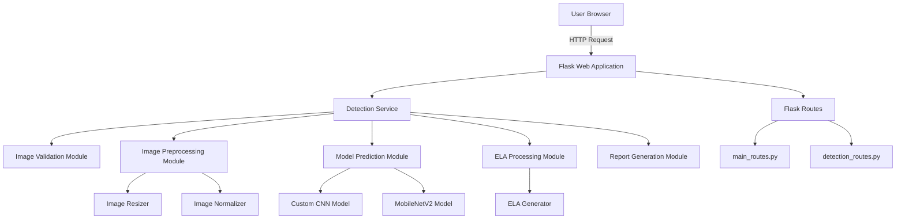

# System Architecture — Image Manipulation Detection System

> **Project:** Image Manipulation Detection System Using Deep Learning  
> **Version:** 1.0.0  
> **Stack:** Python 3.11 · Flask · TensorFlow/Keras · Bootstrap 5  
> **Dataset:** CASIA v1.0 & v2.0  

---

## Table of Contents

1. [Architecture Overview](#1-architecture-overview)
2. [Architecture Principles](#2-architecture-principles)
3. [High-Level Architecture Diagram](#3-high-level-architecture-diagram)
4. [Component Descriptions](#4-component-descriptions)
5. [Data Flow Overview](#5-data-flow-overview)
6. [Configuration Management](#6-configuration-management)
7. [Artifact Storage](#7-artifact-storage)
8. [Technology Stack by Layer](#8-technology-stack-by-layer)

---

## 1. Architecture Overview

The Image Manipulation Detection System is a monolithic web application built on the Flask micro-framework that exposes a browser-based interface for detecting whether a digital image has been tampered with. Users upload an image through the web UI; the backend orchestrates validation, preprocessing, deep-learning inference, Error Level Analysis (ELA) visualisation, and report generation — returning all results to the browser in a single response cycle.

The system is intentionally designed to be:

- **Self-contained** — no external databases or message queues are required for inference.
- **Model-agnostic at runtime** — the model backend (Custom CNN or MobileNetV2) is selected via configuration, making it straightforward to swap or ensemble models without changing service code.
- **Student-deployable** — the entire stack runs on a single machine with a standard Python 3.11 environment and an optional GPU.

### Deployment Topology

```
┌─────────────────────────────────────────────────────────┐
│                    Single Host Machine                  │
│                                                         │
│  ┌────────────┐    HTTP     ┌───────────────────────┐   │
│  │  Browser   │ ◄─────────► │  Flask Dev Server     │   │
│  │ (any OS)   │  :5000      │  (Werkzeug / Gunicorn) │  │
│  └────────────┘             └──────────┬────────────┘   │
│                                        │                │
│                             ┌──────────▼────────────┐   │
│                             │   Python Application  │   │
│                             │   src/ modules        │   │
│                             └──────────┬────────────┘   │
│                                        │                │
│                             ┌──────────▼────────────┐   │
│                             │   artifacts/          │   │
│                             │   models/ plots/      │   │
│                             │   predictions/        │   │
│                             │   reports/            │   │
│                             └───────────────────────┘   │
└─────────────────────────────────────────────────────────┘
```

---

## 2. Architecture Principles

### 2.1 Modularity

Every subsystem is implemented as an independent Python module with a well-defined public interface. The `src/` tree is organised by _technical concern_ (preprocessing, models, services, evaluation, utils) rather than by feature, so individual modules can be developed, tested, and replaced in isolation.

| Principle | Implementation |
|-----------|---------------|
| Independent modules | Each `src/` subdirectory is a self-contained package with its own `__init__.py` |
| Pluggable models | `model_loader.py` abstracts CNN and MobileNetV2 behind a common `load_model()` interface |
| Configurable paths | All file paths and hyperparameters are centralised in `config.py` |

### 2.2 Separation of Concerns

The application is structured in four distinct horizontal layers, each responsible for a single class of concerns:

| Layer | Responsibility | Location |
|-------|---------------|----------|
| **Presentation** | HTML rendering, static assets, HTTP routing | `web/` |
| **Service** | Business logic orchestration | `src/services/` |
| **Domain** | ML models, preprocessing, ELA, evaluation | `src/models/`, `src/preprocessing/`, `src/evaluation/` |
| **Infrastructure** | Logging, validation utilities, exceptions | `src/utils/` |

Flask routes sit at the boundary between the Presentation and Service layers. Routes do _only_ request parsing and response formatting; they delegate all processing to service objects.

### 2.3 Single Responsibility Principle

Each Python file contains exactly one primary class or a tightly related set of functions serving a single purpose:

- `ela_generator.py` — produces ELA images, nothing else.
- `image_resizer.py` — resizes images to the target dimension, nothing else.
- `model_loader.py` — loads a serialised Keras model from disk, nothing else.
- `report_service.py` — composes and serialises the analysis report, nothing else.

This granularity ensures that changes to (e.g.) the ELA algorithm do not ripple into the prediction or reporting subsystems.

### 2.4 Fail-Fast Validation

The `FileValidator` module runs before any downstream processing begins. Invalid files (wrong type, oversized, corrupt JPEG header) are rejected with a descriptive error immediately, preventing wasted compute and obscure downstream errors.

---

## 3. High-Level Architecture Diagram



### Diagram Notes

- **Detection Service** is the central orchestrator; it owns the analysis pipeline and calls each sub-module in sequence.
- **Flask Routes** translate HTTP verbs into service method calls and render Jinja2 templates with the results.
- **Model Prediction Module** (`predictor.py`) delegates to whichever model backend is loaded via `model_loader.py`; both CNN and MobileNetV2 share the same prediction interface.
- **ELA Processing** runs in parallel with (or immediately after) model inference because it does not depend on the prediction result — it only requires the original image file.

---

## 4. Component Descriptions

| Component | File(s) | Responsibility |
|-----------|---------|---------------|
| **Flask App Factory** | `app.py` | Creates and configures the Flask application instance; registers blueprints and extensions |
| **Configuration** | `config.py` | Centralises all runtime parameters: paths, model selection, upload limits, ELA quality settings |
| **Main Routes** | `web/main_routes.py` | Serves the home page (`GET /`) and static informational views |
| **Detection Routes** | `web/detection_routes.py` | Handles `POST /analyze` (image upload), `GET /results/<id>`, and `GET /report/<id>` |
| **Detection Service** | `src/services/detection_service.py` | Orchestrates the full analysis pipeline: validate → preprocess → predict → ELA → report |
| **ELA Service** | `src/services/ela_service.py` | High-level ELA coordination; manages temp file creation and cleanup around `ela_generator` |
| **Report Service** | `src/services/report_service.py` | Assembles prediction results, ELA image path, and metadata into a downloadable PDF report |
| **File Validator** | `src/utils/file_validator.py` | Checks MIME type, file extension, file size, and minimum dimension constraints |
| **Image Loader** | `src/preprocessing/image_loader.py` | Reads image files from disk into PIL Image objects; handles RGB conversion |
| **Image Resizer** | `src/preprocessing/image_resizer.py` | Resizes images to 224 × 224 px using Lanczos resampling |
| **Image Normalizer** | `src/preprocessing/image_normalizer.py` | Scales pixel values to `[0, 1]` and applies per-channel mean subtraction |
| **ELA Generator** | `src/preprocessing/ela_generator.py` | Implements the JPEG Error Level Analysis algorithm; produces amplified difference image |
| **Model Loader** | `src/models/model_loader.py` | Loads a `.keras` or `.h5` model from `artifacts/models/`; caches the model in memory |
| **Predictor** | `src/models/predictor.py` | Runs `model.predict()`, decodes softmax output to `(label, confidence)` tuple |
| **Custom CNN** | `src/models/cnn_model.py` | Defines the custom CNN architecture (Conv2D → BatchNorm → MaxPool → Dense) |
| **MobileNetV2** | `src/models/mobilenet_model.py` | Wraps TensorFlow's pre-trained MobileNetV2 with a custom classification head |
| **Dataset Loader** | `src/data/dataset_loader.py` | Reads CASIA dataset directories; yields `(image_path, label)` pairs |
| **Dataset Splitter** | `src/data/dataset_splitter.py` | Splits dataset into train / validation / test sets with configurable ratios |
| **Dataset Validator** | `src/data/dataset_validator.py` | Checks dataset integrity: file count, label balance, corrupt file detection |
| **Augmentation** | `src/data/augmentation.py` | Applies training-time augmentation: flips, rotations, brightness jitter, zoom |
| **Train CNN** | `src/training/train_cnn.py` | Full training loop for the Custom CNN; calls callbacks and saves best checkpoint |
| **Train MobileNet** | `src/training/train_mobilenet.py` | Fine-tuning loop for MobileNetV2; supports layer-freezing schedule |
| **Callbacks** | `src/training/callbacks.py` | Keras callbacks: EarlyStopping, ModelCheckpoint, ReduceLROnPlateau, CSVLogger |
| **Evaluate** | `src/training/evaluate.py` | Post-training evaluation on the held-out test split |
| **Metrics** | `src/evaluation/metrics.py` | Computes accuracy, precision, recall, F1, AUC-ROC |
| **Confusion Matrix** | `src/evaluation/confusion_matrix.py` | Builds and plots the binary confusion matrix |
| **Visualisation** | `src/evaluation/visualization.py` | Plots training curves (loss / accuracy vs. epoch) |
| **Grad-CAM** | `src/explainability/gradcam.py` | Produces Grad-CAM heatmaps to highlight regions the model attended to |
| **Logger** | `src/utils/logger.py` | Configures Python's `logging` module; writes structured logs to console and file |
| **Exceptions** | `src/utils/exceptions.py` | Custom exception hierarchy: `ValidationError`, `ModelError`, `ELAError`, `ReportError` |
| **Image Utils** | `src/utils/image_utils.py` | Shared helpers: base64 encode for inline HTML, temp-path generation, file hash |

---

## 5. Data Flow Overview

A complete user analysis session proceeds through five logical stages:

```
Stage 1 — HTTP Ingress
  User uploads image via multipart/form-data POST

Stage 2 — Validation Gate
  FileValidator checks MIME, extension, size, dimensions

Stage 3 — Preprocessing Pipeline
  ImageLoader → ImageResizer (224×224) → ImageNormalizer ([0,1])

Stage 4 — Parallel Analysis
  ├── ModelPredictor → (label: Authentic|Tampered, confidence: float)
  └── ELAGenerator  → ela_<uuid>.png saved to artifacts/predictions/

Stage 5 — Response Assembly
  DetectionService aggregates results
  ReportService composes PDF (on demand)
  Flask route renders results template / returns JSON
```

The system is **synchronous** — all stages run in the same HTTP request context. For large images, the preprocessing and inference stages are the dominant latency contributors (typically 200–800 ms on CPU, 50–150 ms on GPU).

---

## 6. Configuration Management

All runtime parameters are defined in [`config.py`](file:///media/salman/p5/5th%20sem/ai/Project_ai/Project_semester/image-manipulation-detection/config.py) as a Python class hierarchy, allowing environment-specific overrides:

```python
# config.py — representative structure

import os

BASE_DIR = os.path.dirname(os.path.abspath(__file__))

class Config:
    """Base configuration shared across all environments."""

    # Flask
    SECRET_KEY = os.environ.get("SECRET_KEY", "dev-secret-key")
    DEBUG = False
    TESTING = False

    # Upload
    MAX_CONTENT_LENGTH = 16 * 1024 * 1024          # 16 MB
    ALLOWED_EXTENSIONS = {"jpg", "jpeg", "png", "bmp", "tiff"}
    UPLOAD_FOLDER = os.path.join(BASE_DIR, "artifacts", "predictions")

    # Model
    MODEL_TYPE = os.environ.get("MODEL_TYPE", "mobilenet")   # "cnn" | "mobilenet"
    CNN_MODEL_PATH = os.path.join(BASE_DIR, "artifacts", "models", "cnn_model.keras")
    MOBILENET_MODEL_PATH = os.path.join(BASE_DIR, "artifacts", "models", "mobilenet_model.keras")
    INPUT_SHAPE = (224, 224, 3)
    NUM_CLASSES = 2
    CLASS_NAMES = ["Authentic", "Tampered"]

    # ELA
    ELA_QUALITY = 90          # JPEG re-compression quality (0–100)
    ELA_AMPLIFIER = 15        # Pixel difference amplification factor
    ELA_OUTPUT_DIR = os.path.join(BASE_DIR, "artifacts", "predictions")

    # Training
    BATCH_SIZE = 32
    EPOCHS = 50
    LEARNING_RATE = 1e-4
    VALIDATION_SPLIT = 0.15
    TEST_SPLIT = 0.15

    # Dataset
    DATASET_ROOT = os.path.join(BASE_DIR, "data")
    CASIA_V1_PATH = os.path.join(DATASET_ROOT, "CASIA1")
    CASIA_V2_PATH = os.path.join(DATASET_ROOT, "CASIA2")

    # Logging
    LOG_LEVEL = "INFO"
    LOG_FILE = os.path.join(BASE_DIR, "artifacts", "app.log")

    # Reports
    REPORT_OUTPUT_DIR = os.path.join(BASE_DIR, "artifacts", "reports")


class DevelopmentConfig(Config):
    DEBUG = True
    LOG_LEVEL = "DEBUG"


class ProductionConfig(Config):
    DEBUG = False
    LOG_LEVEL = "WARNING"


class TestingConfig(Config):
    TESTING = True
    MAX_CONTENT_LENGTH = 1 * 1024 * 1024    # 1 MB limit for tests
```

### Key Configuration Groups

| Group | Key Parameters | Purpose |
|-------|---------------|---------|
| **Flask Core** | `SECRET_KEY`, `DEBUG`, `MAX_CONTENT_LENGTH` | Framework settings and upload limits |
| **Model** | `MODEL_TYPE`, `CNN_MODEL_PATH`, `MOBILENET_MODEL_PATH`, `INPUT_SHAPE` | Selects which model binary to load |
| **ELA** | `ELA_QUALITY`, `ELA_AMPLIFIER`, `ELA_OUTPUT_DIR` | Controls JPEG re-compression quality and visual amplification |
| **Training** | `BATCH_SIZE`, `EPOCHS`, `LEARNING_RATE`, splits | Hyperparameters used by training scripts |
| **Dataset** | `CASIA_V1_PATH`, `CASIA_V2_PATH` | Filesystem paths to raw dataset directories |
| **Logging** | `LOG_LEVEL`, `LOG_FILE` | Log verbosity and output destination |

---

## 7. Artifact Storage

The `artifacts/` directory is the runtime output store. It is **not committed to version control** (`.gitignore` excludes it) but must exist before the application starts.

```
artifacts/
├── models/
│   ├── cnn_model.keras          # Saved Custom CNN weights + architecture
│   ├── mobilenet_model.keras    # Saved MobileNetV2 fine-tuned weights
│   └── training_history.json   # JSON export of Keras training History object
│
├── plots/
│   ├── cnn_loss_curve.png       # Training vs. validation loss (CNN)
│   ├── cnn_accuracy_curve.png   # Training vs. validation accuracy (CNN)
│   ├── mobilenet_loss_curve.png
│   ├── mobilenet_accuracy_curve.png
│   ├── confusion_matrix_cnn.png
│   └── confusion_matrix_mobilenet.png
│
├── predictions/
│   ├── uploads/                 # Temporarily stored uploaded images (UUID-named)
│   └── ela/                     # ELA output images (UUID-named)
│
└── reports/
    └── report_<session_id>.pdf  # On-demand PDF analysis reports
```

> [!IMPORTANT]
> The `artifacts/models/` directory must contain at least one trained `.keras` file before the web application can serve analysis requests. Run `python scripts/train.py` to generate model files from the CASIA dataset.

---

## 8. Technology Stack by Layer

| Layer | Technology | Version | Role |
|-------|-----------|---------|------|
| **Frontend** | HTML5 / CSS3 | — | Page structure and styling |
| **Frontend** | Bootstrap | 5.3 | Responsive layout, UI components |
| **Frontend** | JavaScript (Vanilla) | ES2020 | Image preview, form interaction, progress feedback |
| **Frontend** | Jinja2 | 3.x | Server-side HTML templating |
| **Web Framework** | Flask | 3.x | HTTP routing, request handling, response rendering |
| **Web Server (dev)** | Werkzeug | 3.x | Bundled WSGI development server |
| **Language** | Python | 3.11 | Application runtime |
| **Deep Learning** | TensorFlow | 2.15+ | Model definition, training, and inference |
| **Deep Learning** | Keras | 3.x (via TF) | High-level model API, callbacks, preprocessing |
| **Image Processing** | Pillow (PIL) | 10.x | Image I/O, JPEG re-compression for ELA |
| **Numerical** | NumPy | 1.26+ | Array operations, pixel arithmetic |
| **Visualisation** | Matplotlib | 3.8+ | Training curves, confusion matrix plots |
| **Visualisation** | Seaborn | 0.13+ | Statistical plot styling |
| **Data Science** | scikit-learn | 1.4+ | Metrics (F1, AUC), dataset splitting |
| **PDF Generation** | ReportLab / FPDF2 | — | PDF report composition |
| **Explainability** | (Custom Grad-CAM) | — | Layer gradient visualisation |
| **Notebooks** | Jupyter | — | Experiment tracking and exploration |

> [!NOTE]
> TensorFlow 2.15+ is chosen because it ships with Keras 3 built-in and provides stable `tf.keras` APIs for both CNN definition and MobileNetV2 transfer learning. GPU acceleration is available automatically if CUDA 12+ and cuDNN 8+ are installed.
