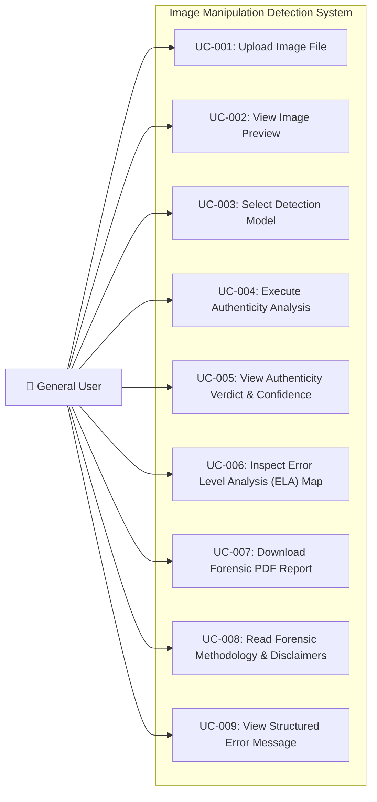

# Use Case Diagram & Actor Specifications

## 1. System Actors

| Actor | Type | Description | Responsibilities |
| :--- | :--- | :--- | :--- |
| **General User** | Human (Primary) | Journalist, researcher, student, or analyst seeking image verification | Uploads photos, inspects ELA maps, views verdicts, downloads reports |
| **Image Validation Module** | System Actor | Input verification service (`file_validator.py`) | Sanitizes filenames, checks size bounds, validates magic-byte integrity |
| **Preprocessing Module** | System Actor | Numerical normalization and resizing pipeline | Converts colorspaces, rescales to 224x224, scales pixel values |
| **Deep Learning Inference Module**| System Actor | Keras model execution engine (`predictor.py`) | Executes forward pass for Custom CNN or MobileNetV2 |
| **ELA Processing Module** | System Actor | Physical forensic recompression utility (`ela_generator.py`) | Computes JPEG residual differences and enhances contrast maps |
| **Report Generation Module** | System Actor | Document compiler (`report_service.py`) | Builds and formats multi-page PDF forensic analysis summaries |

---

## 2. Use Case Diagram

---

## 3. Detailed Use Case Specifications

### UC-004: Execute Authenticity Analysis
- **Actor:** General User.
- **Preconditions:** Valid image file staged in browser upload component.
- **Trigger:** User clicks "Analyze Image" button.
- **Main Flow:**
  1. Frontend submits image via `POST /analyze`.
  2. Image Validation Module verifies MIME type and file boundaries.
  3. Preprocessing Module normalizes image into batch tensor.
  4. Deep Learning Inference Module executes model prediction and outputs confidence.
  5. ELA Processing Module generates high-contrast JPEG compression residual map.
  6. Results Dashboard renders verdict badge, confidence bar, and side-by-side comparison.
- **Alternative Flow (Validation Failure):**
  - Validation module rejects file. System returns HTTP 400 error page with clear guidance (UC-009).

### UC-007: Download Forensic PDF Report
- **Actor:** General User.
- **Preconditions:** User has completed an active analysis session.
- **Trigger:** User clicks "Download PDF Report".
- **Main Flow:**
  1. Frontend sends `GET /report/<session_id>`.
  2. Report Generation Module pulls result metadata and stored images.
  3. PDF is compiled in memory with timestamps, model metrics, original photo, ELA map, and mandatory disclaimers.
  4. File is delivered to the user as a browser download attachment.
  5. Ephemeral session cleanup is scheduled.
