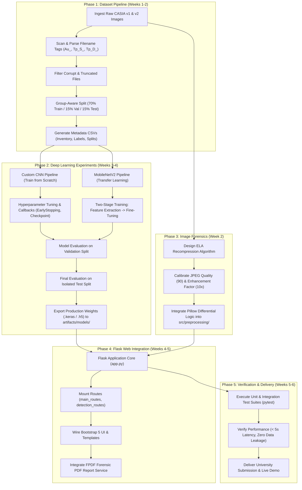
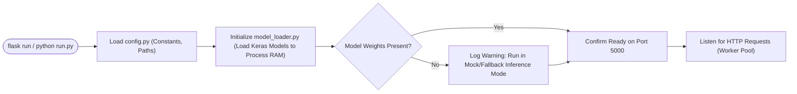

# Workflow Diagrams

## 1. Development & Experimentation Workflow
This workflow illustrates how the engineering team advances through dataset ingestion, model training, evaluation, and application packaging across the 6-week project lifecycle.

---

## 2. Server Startup & Request Lifecycle Workflow

