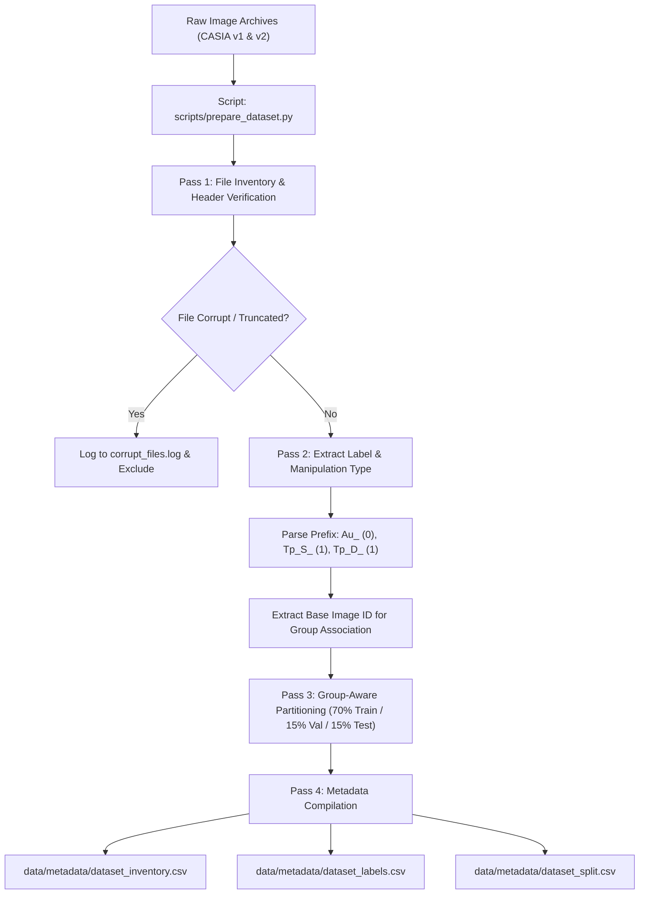

# Dataset Preparation Pipeline & Automation Specification

## 1. Pipeline Overview
The dataset preparation pipeline ingests raw CASIA v1.0 and CASIA v2.0 image collections, validates binary integrity, extracts authentic/manipulated labels from standardized filename prefixes, performs group-aware splitting to prevent data leakage, and compiles clean inventory metadata CSV files.



---

## 2. Directory Layout Requirements

```
data/
├── raw/
│   ├── casia_v1/             # 1,721 raw CASIA v1 images (READ-ONLY)
│   └── casia_v2/             # 12,614 raw CASIA v2 images (READ-ONLY)
├── annotations/
│   ├── casia_v1/             # Binary masks from namtpham/casia1groundtruth
│   └── casia_v2/             # Binary masks from namtpham/casia2groundtruth
├── processed/
│   ├── authentic/            # Standardized 224x224 RGB authentic samples
│   └── manipulated/          # Standardized 224x224 RGB manipulated samples
├── splits/
│   ├── train/                # Symlinks or organized files for training split
│   ├── validation/           # Symlinks or organized files for validation split
│   └── test/                 # Symlinks or organized files for test split (ISOLATED)
└── metadata/
    ├── dataset_inventory.csv # Complete catalog of all scanned image files
    ├── dataset_labels.csv    # Label and manipulation-type mappings
    └── dataset_split.csv     # Split assignments with group IDs
```

---

## 3. Preparation Script Operations (`scripts/prepare_dataset.py`)

### 3.1 Step 1: Scan and Ingestion
- Recursively scan `data/raw/casia_v1/` and `data/raw/casia_v2/`.
- Ignore hidden OS files (e.g., `.DS_Store`, `Thumbs.db`).
- Check file extensions: accept `.jpg`, `.jpeg`, `.tif`, `.png`.

### 3.2 Step 2: Integrity and Format Verification
- Attempt to open each image using `PIL.Image.open()` and run `img.verify()`.
- Identify truncated JPEG streams or unreadable byte headers.
- Record image dimensions (Width, Height), color mode (RGB, L, CMYK), and byte size.

### 3.3 Step 3: Label Assignment
- Follow authoritative prefix parsing:
  - Starts with `Au_` $\rightarrow$ Class `0` ("Authentic").
  - Starts with `Tp_` $\rightarrow$ Class `1` ("Manipulated").
    - If `Tp_S_` $\rightarrow$ Sub-type: Copy-Move.
    - If `Tp_D_` $\rightarrow$ Sub-type: Image Splicing.
- If a filename violates these patterns, log a warning and mark as anomalous in `dataset_inventory.csv`.

### 3.4 Step 4: Group Identification
- To prevent data leakage, donor authentic images and all tampered derivatives derived from that donor must be grouped together under a shared `group_id`.

### 3.5 Step 5: Split Execution & Output Generation
- Execute GroupShuffleSplit: 70% Training, 15% Validation, 15% Testing.
- Write the finalized metadata records to `data/metadata/`.
