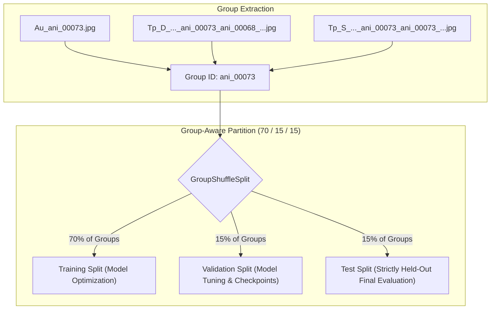

# Group-Aware Dataset Splitting Strategy

## 1. The Critical Problem: Data Leakage in Image Forensics
In standard computer vision benchmarks (e.g. ImageNet, CIFAR-10), samples are independent objects. However, in digital image forensics datasets like CASIA:
- A tampered image $I_{\text{tampered}}$ is constructed by copying or splicing regions from an authentic donor image $I_{\text{donor}}$.
- If $I_{\text{donor}}$ is placed into the **Training Set** while $I_{\text{tampered}}$ is placed into the **Test Set**, the neural network can recognize identical background textures, lighting setups, or camera sensor noise patterns rather than learning manipulation artifacts.
- This creates **data leakage**, resulting in artificially inflated benchmark test metrics that collapse when deployed on real-world unseen images.

---

## 2. Group-Aware Splitting Methodology

To guarantee valid scientific evaluation, dataset partitioning must be **group-aware**:
1. Every authentic donor image and all tampered derivatives generated from that donor must belong to the **same cluster (group)**.
2. The split algorithm partitions **groups**, never isolated images.



---

## 3. Split Distribution Targets

| Split Partition | Ratio | Estimated Images (CASIA v2) | Purpose & Policy |
| :--- | :---: | :---: | :--- |
| **Training** | **70%** | ~8,830 images | Parameter optimization via gradient descent; data augmentation applied |
| **Validation**| **15%** | ~1,892 images | Epoch evaluation, early stopping triggers, learning rate decay scheduling |
| **Testing** | **15%** | ~1,892 images | **ISOLATED:** Evaluated exactly once after model architecture is finalized |

---

## 4. Implementation Algorithm (scikit-learn)

```python
import pandas as pd
from sklearn.model_selection import GroupShuffleSplit

def execute_group_aware_split(metadata_df: pd.DataFrame) -> pd.DataFrame:
    """Split dataset into train, val, test splits ensuring no group leakage.
    
    Args:
        metadata_df: DataFrame with 'image_id', 'group_id', 'label'.
        
    Returns:
        DataFrame with an added 'split' column ('train', 'validation', 'test').
    """
    # First split: 70% train, 30% temp (val + test)
    gss_train = GroupShuffleSplit(n_splits=1, train_size=0.70, random_state=42)
    train_idx, temp_idx = next(gss_train.split(metadata_df, groups=metadata_df['group_id']))
    
    train_df = metadata_df.iloc[train_idx].copy()
    temp_df = metadata_df.iloc[temp_idx].copy()
    train_df['split'] = 'train'
    
    # Second split: split temp 50/50 -> 15% validation, 15% test
    gss_val = GroupShuffleSplit(n_splits=1, train_size=0.50, random_state=42)
    val_sub_idx, test_sub_idx = next(gss_val.split(temp_df, groups=temp_df['group_id']))
    
    val_df = temp_df.iloc[val_sub_idx].copy()
    test_df = temp_df.iloc[test_sub_idx].copy()
    val_df['split'] = 'validation'
    test_df['split'] = 'test'
    
    final_df = pd.concat([train_df, val_df, test_df]).sort_index()
    return final_df
```
