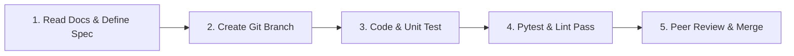

# Team Development Workflow & Lifecycle Governance

## 1. Feature Lifecycle
All code additions follow a disciplined 5-stage lifecycle:

---

## 2. Module Development Order (Dependency-First)

To prevent circular dependencies and blocking team members, modules must be built strictly in this order:

1. **Phase 1: Utilities (`src/utils/`)**
   - `logger.py`, `exceptions.py`, `file_validator.py`, `image_utils.py`
2. **Phase 2: Forensic Preprocessing (`src/preprocessing/`)**
   - `ela_generator.py`, `image_loader.py`, `image_resizer.py`, `image_normalizer.py`
3. **Phase 3: Dataset Ingestion (`src/data/`, `scripts/prepare_dataset.py`)**
   - `dataset_loader.py`, `dataset_validator.py`, `dataset_splitter.py`, `augmentation.py`
4. **Phase 4: Neural Architectures & Training (`src/models/`, `src/training/`)**
   - `cnn_model.py`, `mobilenet_model.py`, `callbacks.py`, `train_cnn.py`, `train_mobilenet.py`
5. **Phase 5: Inference Services (`src/models/model_loader.py`, `predictor.py`, `src/services/`)**
   - `detection_service.py`, `ela_service.py`, `report_service.py`
6. **Phase 6: Web Presentation Layer (`web/`, `app.py`)**
   - `main_routes.py`, `detection_routes.py`, Jinja2 templates, static CSS/JS
