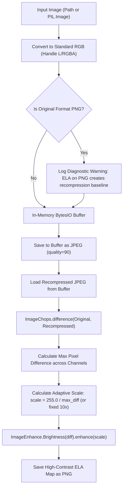

# ELA Implementation Architecture & Algorithmic Design

## 1. Algorithmic Pipeline
The ELA generator is implemented strictly in `src/preprocessing/ela_generator.py` using Pillow (PIL) for image operations.



---

## 2. Python Reference Implementation (`src/preprocessing/ela_generator.py`)

```python
from __future__ import annotations
import io
from pathlib import Path
from typing import Optional, Union
from PIL import Image, ImageChops, ImageEnhance
from config import Config
from src.utils.logger import get_logger

logger = get_logger(__name__)

class ELAGenerator:
    """Generates Error Level Analysis (ELA) visualization maps for digital images."""

    @staticmethod
    def generate(
        image_input: Union[str, Path, Image.Image],
        output_path: Optional[Union[str, Path]] = None,
        quality: int = 90,
        enhancement_factor: float = 10.0
    ) -> Image.Image:
        """Generate an ELA visualization for an image.

        Args:
            image_input: Absolute file path or pre-loaded PIL Image object.
            output_path: Optional destination path to save the generated PNG.
            quality: JPEG recompression quality factor (1-95). Defaults to 90.
            enhancement_factor: Brightness multiplier applied to pixel differences.

        Returns:
            A PIL Image object containing the enhanced ELA visualization.

        Raises:
            FileNotFoundError: If image file path does not exist.
            ValueError: If quality is outside 1-95 or factor <= 0.
            IOError: If image cannot be decoded.
        """
        if not (1 <= quality <= 95):
            raise ValueError(f"Quality must be between 1 and 95, received: {quality}")
        if enhancement_factor <= 0:
            raise ValueError("Enhancement factor must be greater than zero.")

        # Ingest image
        if isinstance(image_input, (str, Path)):
            src_path = Path(image_input)
            if not src_path.exists():
                raise FileNotFoundError(f"Source image not found: {src_path}")
            orig_img = Image.open(src_path)
            if src_path.suffix.lower() == ".png":
                logger.warning(
                    "Source image '%s' is PNG. ELA on PNG converts lossless pixels to JPEG, "
                    "which introduces an artificial baseline error across the canvas.",
                    src_path.name
                )
        else:
            orig_img = image_input

        # Standardize colorspace
        orig_rgb = orig_img.convert("RGB")

        # In-memory JPEG recompression
        buffer = io.BytesIO()
        orig_rgb.save(buffer, format="JPEG", quality=quality)
        buffer.seek(0)
        recompressed_img = Image.open(buffer)

        # Compute absolute difference
        diff_img = ImageChops.difference(orig_rgb, recompressed_img)

        # Apply difference enhancement
        enhancer = ImageEnhance.Brightness(diff_img)
        ela_img = enhancer.enhance(enhancement_factor)

        # Persist if destination specified
        if output_path is not None:
            out_file = Path(output_path)
            out_file.parent.mkdir(parents=True, exist_ok=True)
            ela_img.save(out_file, format="PNG")
            logger.info("ELA image saved successfully to %s", out_file)

        return ela_img
```
