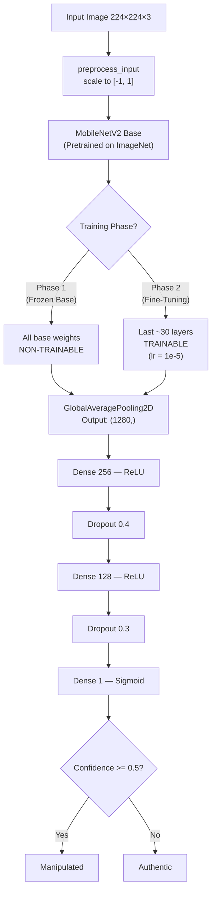

# MobileNetV2 Architecture for Image Forensics

## Table of Contents

1. [MobileNetV2 Overview](#1-mobilenetv2-overview)
2. [Why MobileNetV2 for Image Forensics](#2-why-mobilenetv2-for-image-forensics)
3. [Transfer Learning Strategy](#3-transfer-learning-strategy)
4. [Classification Head Architecture](#4-classification-head-architecture)
5. [Training Configuration](#5-training-configuration)
6. [Input Preprocessing](#6-input-preprocessing)
7. [Architecture Diagram](#7-architecture-diagram)
8. [Model Saving](#8-model-saving)
9. [Limitations and Caveats](#9-limitations-and-caveats)

---

## 1. MobileNetV2 Overview

MobileNetV2 is a convolutional neural network architecture developed by Google and introduced in the paper *"MobileNetV2: Inverted Residuals and Linear Bottlenecks"* (Sandler et al., 2018). It was designed specifically to be efficient for mobile and embedded vision applications while maintaining competitive accuracy on image classification benchmarks.

### Core Architectural Innovations

#### 1.1 Depthwise Separable Convolutions

Traditional convolutions apply a filter across all input channels simultaneously. Depthwise separable convolutions factorize this into two steps:

| Step | Operation | Description |
|---|---|---|
| **Depthwise Convolution** | Per-channel spatial filtering | Applies a single filter per input channel |
| **Pointwise Convolution** | 1×1 convolution | Combines depthwise outputs across channels |

This factorization reduces computational cost by approximately 8–9× compared to standard convolutions, with minimal accuracy loss.

#### 1.2 Inverted Residual Blocks (Bottleneck Blocks)

MobileNetV2's primary building block is the **Inverted Residual** (also called a bottleneck block):

```
Input (low-dim) → Expand (1×1, expand to high-dim) → Depthwise Conv (3×3) → Project (1×1, compress back) → Output (low-dim)
```

Crucially, residual skip connections are placed at the **compressed** (narrow) representations, opposite to standard ResNet residuals which connect at the wide layers. This design:
- Reduces the need to store high-dimensional intermediate activations
- Allows gradients to flow through the skip connections efficiently
- Maintains representational capacity with fewer parameters

#### 1.3 Linear Bottlenecks

The final projection in each inverted residual uses **no activation function** (linear activation). MobileNetV2's authors showed that applying ReLU to low-dimensional manifolds destroys information — linear activations preserve it.

### Pretrained Weights

The version used in this project is pretrained on **ImageNet LSVRC-2012**, which contains:
- 1.28 million training images
- 1,000 object classes
- Extensive coverage of textures, edges, colors, and shapes

This pretraining gives MobileNetV2 strong general-purpose visual feature detectors that can be repurposed for forensic classification via fine-tuning.

---

## 2. Why MobileNetV2 for Image Forensics

### Advantages

| Advantage | Detail |
|---|---|
| **Strong Pre-trained Feature Detectors** | Trained on 1.28M diverse images; early layers detect edges, textures, and color patterns that are relevant to compression artifact analysis |
| **Fast Inference** | Optimized depthwise separable convolutions enable real-time prediction — critical for a web application |
| **Small Model Size** | ~14MB base model; practical for deployment on resource-constrained environments |
| **Good Generalization with Limited Data** | Transfer learning requires far fewer training images to reach good performance compared to training from scratch |
| **Mature Framework Support** | Available directly in `tf.keras.applications.MobileNetV2` with no external dependencies |
| **Well-Studied Architecture** | Extensive literature and community experience provides guidance on fine-tuning strategies |

### Disadvantages

| Disadvantage | Detail |
|---|---|
| **Not Pre-trained on Forensic Data** | ImageNet contains object images, not forensic artifacts. Low-level JPEG compression patterns may not transfer well |
| **Feature Reuse Assumption May Not Hold** | The implicit assumption of transfer learning — that ImageNet features are useful for the target task — may be weaker for forensics than for typical computer vision tasks |
| **Early Layer Adaptation is Difficult** | In Phase 1 (feature extraction), the base layers are frozen. If forensically relevant features require early-layer changes, Phase 1 results will be limited |
| **Fixed Architecture** | Unlike the Custom CNN, the base architecture cannot be changed. The only control points are the classification head and the number of unfrozen base layers during fine-tuning |
| **Potential Negative Transfer** | In rare cases, strongly learned ImageNet priors can harm performance on a sufficiently different target domain |

---

## 3. Transfer Learning Strategy

Transfer learning is applied in **two sequential phases**. This phased approach is standard practice when adapting a pretrained model to a new domain with limited training data.

### Phase 1 — Feature Extraction (Frozen Base)

In the first phase, the **entire MobileNetV2 base is frozen** (all weights are non-trainable). Only the custom classification head (described in Section 4) has trainable weights.

**Purpose**: Allow the classification head to learn a good mapping from MobileNetV2's existing feature representations to the forensics task labels. If fine-tuning were applied immediately, the high initial learning rate combined with untrained head weights could destroy the pretrained base layer representations ("catastrophic forgetting").

**Procedure**:
1. Load `MobileNetV2(weights='imagenet', include_top=False, input_shape=(224,224,3))`
2. Set `base_model.trainable = False`
3. Attach the custom classification head
4. Compile with `Adam(lr=0.001)`
5. Train for 20 epochs (or until early stopping)

### Phase 2 — Fine-Tuning (Partial Unfreeze)

After Phase 1, the last **~30 layers** of the MobileNetV2 base are unfrozen, while earlier layers remain frozen.

**Purpose**: Allow the deeper layers of the base (which encode more task-specific, higher-level features) to adapt to forensic patterns, while the lower layers (which encode general-purpose edge and texture detectors useful for all visual tasks) remain fixed.

**Procedure**:
1. Load the Phase 1 checkpoint
2. Unfreeze layers from `base_model.layers[-30:]` onward
3. Recompile with a **much lower learning rate**: `Adam(lr=1e-5)`
4. Train for up to 30 additional epochs with `EarlyStopping(patience=10)`

> [!IMPORTANT]
> Phase 2 must use a **significantly lower learning rate** than Phase 1. A high learning rate during fine-tuning can rapidly corrupt the carefully pretrained feature representations in the base layers, undoing the benefit of the pretrained weights.

### Why ~30 Layers?

The last 30 layers of MobileNetV2 correspond to the final inverted residual blocks, which encode the highest-level feature representations. These are the layers most likely to encode object-level concepts specific to ImageNet (e.g., "dog features") that least directly apply to forensic artifact detection. Unfreezing these allows them to adapt while preserving the foundational general-purpose features in earlier layers.

---

## 4. Classification Head Architecture

The custom classification head is attached to the output of MobileNetV2's convolutional base (after `GlobalAveragePooling2D`):

| # | Layer | Configuration | Output Shape |
|---|---|---|---|
| 1 | `GlobalAveragePooling2D` | — | `(1280,)` |
| 2 | `Dense` | 256 units, ReLU activation | `(256,)` |
| 3 | `Dropout` | Rate = 0.4 | `(256,)` |
| 4 | `Dense` | 128 units, ReLU activation | `(128,)` |
| 5 | `Dropout` | Rate = 0.3 | `(128,)` |
| 6 | `Dense` (Output) | 1 unit, Sigmoid activation | `(1,)` |

> [!NOTE]
> `GlobalAveragePooling2D` is used instead of `Flatten` because:
> - It dramatically reduces the number of parameters entering the dense layers
> - It provides better regularization by computing the spatial average of each feature map
> - It is consistent with MobileNetV2's original design for the classification stage

**Head Design Rationale**:
- Two dense layers (256 → 128) provide a moderate classification head — complex enough to learn from MobileNetV2 features, but not so large as to overfit on a ~14,000-image dataset
- Dropout at 0.4 and 0.3 provides regularization appropriate for the head's sizes
- Sigmoid output produces a probability score for the binary classification decision

---

## 5. Training Configuration

### Phase 1: Feature Extraction

| Parameter | Value |
|---|---|
| **Trainable Layers** | Classification head only |
| **Optimizer** | Adam |
| **Learning Rate** | 0.001 |
| **Batch Size** | 32 |
| **Epochs** | 20 (maximum) |
| **Loss** | Binary Cross-Entropy |
| **Callbacks** | EarlyStopping (patience=5), ModelCheckpoint |

### Phase 2: Fine-Tuning

| Parameter | Value |
|---|---|
| **Trainable Layers** | Head + last ~30 MobileNetV2 layers |
| **Optimizer** | Adam |
| **Learning Rate** | 1e-5 (100× lower than Phase 1) |
| **Batch Size** | 32 |
| **Epochs** | 30 (maximum) |
| **Loss** | Binary Cross-Entropy |
| **Callbacks** | EarlyStopping (patience=10), ModelCheckpoint, ReduceLROnPlateau |

---

## 6. Input Preprocessing

MobileNetV2 requires a specific preprocessing function that **differs from standard [0, 1] normalization**.

### MobileNetV2-Specific Preprocessing

```python
# Preprocessing for MobileNetV2 (documentation only)
from tensorflow.keras.applications.mobilenet_v2 import preprocess_input

# preprocess_input scales pixel values from [0, 255] to [-1, 1]
# Formula: x = (x / 127.5) - 1.0
```

### Why This Matters

| Preprocessing | Range | Suitable For |
|---|---|---|
| `/255.0` (standard) | [0.0, 1.0] | Custom CNN, most from-scratch models |
| `preprocess_input` (MobileNetV2) | [−1.0, 1.0] | MobileNetV2, MobileNetV1 |
| `tf.keras.applications.vgg16.preprocess_input` | Centered around ImageNet mean | VGG16, VGG19 |

> [!WARNING]
> Applying incorrect preprocessing (e.g., standard [0, 1] normalization instead of `preprocess_input`) to MobileNetV2 will produce incorrect activations in the base layers, degrading performance significantly. This is a common source of subtle bugs in transfer learning implementations.

**Consistency Requirement**: The same `preprocess_input` function used during training **must** be applied to every image at inference time in the Flask web application.

---

## 7. Architecture Diagram

The diagram below illustrates the two-phase training strategy and the full model architecture:



---

## 8. Model Saving

| Format | Path | Notes |
|---|---|---|
| **Keras HDF5** | `artifacts/models/mobilenet_model.h5` | Complete model (architecture + weights) |
| **Phase 1 Checkpoint** | `artifacts/models/mobilenet_phase1_best.h5` | Best validation loss after Phase 1 |
| **Phase 2 Checkpoint** | `artifacts/models/mobilenet_phase2_best.h5` | Best validation loss after Phase 2 |

```python
# Model saving sketch (documentation only)
# After Phase 1:
# model.save('artifacts/models/mobilenet_phase1_best.h5')

# After Phase 2 (fine-tuning):
# model.save('artifacts/models/mobilenet_model.h5')
```

> [!IMPORTANT]
> When saving a fine-tuned MobileNetV2 model, ensure the **entire model** (base + head) is saved, not just the classification head weights. The fine-tuning modifies weights in the base layers, so only saving the head will lose those adapted weights.

---

## 9. Limitations and Caveats

### 9.1 Domain Gap Between ImageNet and Image Forensics

ImageNet was collected for semantic object recognition. The features learned — detecting wheels, eyes, fur textures, etc. — are categorically different from the low-level JPEG compression artifacts that indicate image manipulation. While general-purpose edge detectors in early layers are useful, the high-level semantic features may not transfer directly.

### 9.2 ELA Interaction with MobileNetV2 Preprocessing

If ELA images are used as input, the resulting ELA visualization (which highlights difference levels) must be preprocessed using `preprocess_input`. The ELA image has different statistical properties than a standard photograph (brighter regions = higher compression error), and it is an open question whether ImageNet-pretrained weights are optimally suited to interpret ELA images.

### 9.3 Fine-Tuning Layer Count is a Hyperparameter

The choice of "last ~30 layers" for Phase 2 fine-tuning is a reasonable starting point but not guaranteed to be optimal. Too few unfrozen layers may leave base layer representations too domain-general; too many may require more training data to avoid catastrophic forgetting.

### 9.4 Not Suitable for Detecting GAN-Generated Imagery

MobileNetV2, like the Custom CNN, was not designed to detect GAN-based image forgery or deepfakes. The CASIA dataset contains traditional manipulation types (splicing, copy-move). Both models may fail on modern AI-generated manipulation.

### 9.5 Inference Speed vs. Accuracy Trade-off

MobileNetV2 is optimized for speed, achieving this by reducing model complexity. For forensics tasks requiring very high sensitivity, a larger, more computationally expensive model (e.g., ResNet50, EfficientNet) might achieve better recall at the cost of inference speed.

---

*Document Version: 1.0 | Model: MobileNetV2 (Transfer Learning) | Project: Image Manipulation Detection System*
