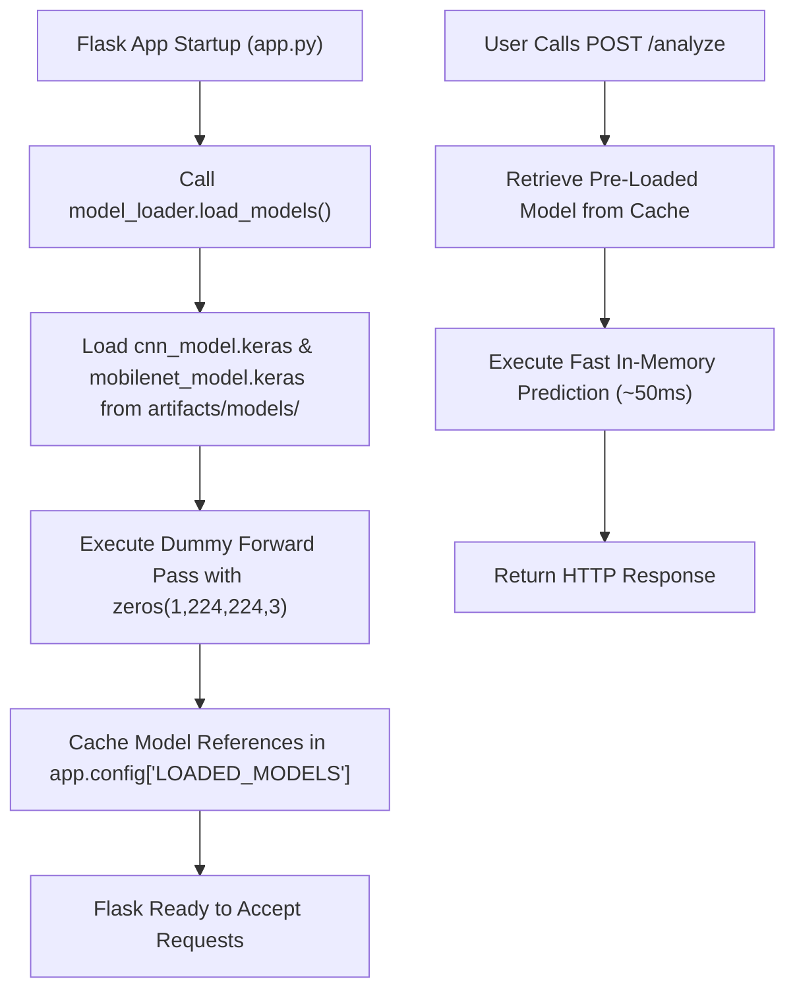

# Model Serving & Production Deployment Architecture

## 1. Model Loading Strategy: In-Memory Resident State
In a web application environment, reloading deep learning weights from disk during HTTP request handling introduces massive latency (~2 to 5 seconds per request) and causes severe memory fragmentation.

To ensure production responsiveness:
- Models are instantiated and cached **once** in process memory during Flask app initialization (`app.py`).
- Worker threads share the in-memory graph via `src/models/model_loader.py`.
- Requests execute thread-safe forward passes via `src/models/predictor.py`.



---

## 2. Model Loader Implementation Architecture (`src/models/model_loader.py`)

```python
from pathlib import Path
from typing import Dict, Optional
import tensorflow as tf
from config import Config
from src.utils.logger import get_logger

logger = get_logger(__name__)

class ModelRegistry:
    """Thread-safe in-memory cache for deep learning models."""
    _models: Dict[str, tf.keras.Model] = {}

    @classmethod
    def load_all(cls) -> None:
        """Load trained models from artifacts directory into memory."""
        models_to_load = {
            "cnn": Path(Config.MODEL_DIR) / "cnn_model.keras",
            "mobilenet": Path(Config.MODEL_DIR) / "mobilenet_model.keras",
        }
        
        for name, path in models_to_load.items():
            if path.exists():
                try:
                    logger.info("Loading model '%s' from %s", name, path)
                    model = tf.keras.models.load_model(str(path))
                    # Perform warmup inference to build computation graph
                    dummy_input = tf.zeros((1, 224, 224, 3), dtype=tf.float32)
                    _ = model(dummy_input, training=False)
                    cls._models[name] = model
                    logger.info("Model '%s' loaded and warmed up successfully.", name)
                except Exception as e:
                    logger.error("Failed to load model '%s': %s", name, e)
            else:
                logger.warning("Model file '%s' not found. Fallback mode active.", path)

    @classmethod
    def get_model(cls, model_name: str) -> Optional[tf.keras.Model]:
        """Retrieve pre-loaded model instance."""
        return cls._models.get(model_name)
```
