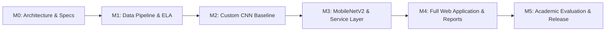

# Development Roadmap & Milestone Architecture

## 1. Release Milestones

---

## 2. Milestone Deliverables

### Milestone 0: Architectural Baseline (Week 1)
- Complete technical documentation, ADRs, and schema definitions.
- Git repository structure and Python 3.11 virtual environment initialized.

### Milestone 1: Data Pipeline & ELA Engine (Week 2)
- Ingested CASIA v1 and v2 raw archives.
- Group-aware dataset splitter and metadata CSVs generated.
- Functional `ELAGenerator` passing all unit tests.

### Milestone 2: Custom CNN Classifier (Week 3)
- Custom 4-block ConvNet trained on Google Colab GPU.
- Checkpointed `cnn_model.keras` achieving stable validation metrics.

### Milestone 3: Transfer Learning & Service Core (Week 4)
- Two-phase fine-tuned MobileNetV2 trained and benchmarked against CNN.
- Flask backend service layer (`detection_service.py`) operational.

### Milestone 4: Interactive Web UI & PDF Export (Week 5)
- Fully responsive Bootstrap 5 interface with live image preview.
- Integrated `report_service.py` generating forensic PDF summaries.

### Milestone 5: Final Submission & Defense (Week 6)
- Comprehensive test coverage (>80%), zero unresolved bugs, and final project documentation.
