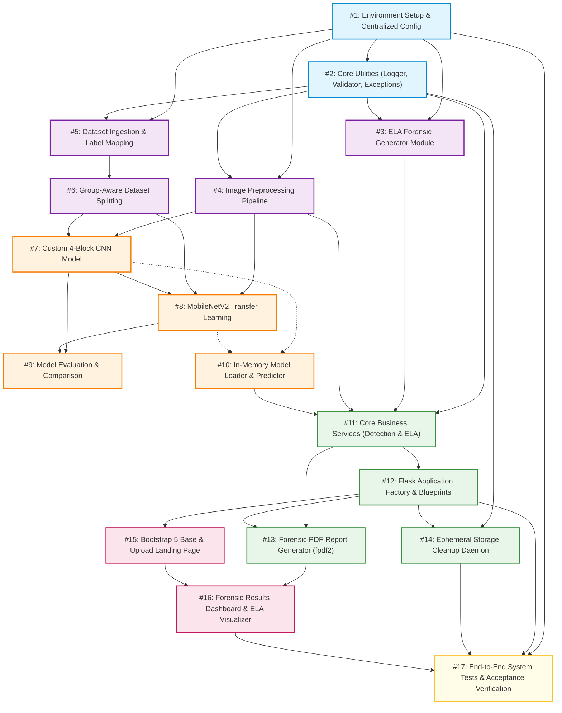

# Master GitHub Issues & AI Implementation Roadmap

This document serves as the master navigation index and dependency map for all 17 step-by-step implementation issues. Each issue file in [`.github/ISSUES/`](../../.github/ISSUES/) is formatted as a self-contained AI prompt. You can copy-paste the text of any issue directly into an AI coding assistant (or create a GitHub Issue), and the AI will have all necessary context, architectural rules, target files, and pre-reading documentation links to complete the task autonomously.

---

## 1. Master Issue Dependency Graph

---

## 2. Step-by-Step Issues Catalog

| Issue ID & Title | Phase / Milestone | Direct Prompt File | Dependencies | Target Artifacts |
| :--- | :--- | :--- | :--- | :--- |
| **[#1] Dependencies, Environment & Centralized Config** | Phase 1 (M0) | [`.github/ISSUES/ISSUE_01_ENVIRONMENT_CONFIG.md`](../../.github/ISSUES/ISSUE_01_ENVIRONMENT_CONFIG.md) | None | `requirements.txt`, `config.py`, `.env.example` |
| **[#2] Core System Utilities (Logger, Validator, Exceptions)** | Phase 1 (M0) | [`.github/ISSUES/ISSUE_02_CORE_SYSTEM_UTILITIES.md`](../../.github/ISSUES/ISSUE_02_CORE_SYSTEM_UTILITIES.md) | #1 | `src/utils/*`, `tests/test_file_validation.py` |
| **[#3] Error Level Analysis (ELA) Generator Module** | Phase 2 (M1) | [`.github/ISSUES/ISSUE_03_ELA_GENERATOR.md`](../../.github/ISSUES/ISSUE_03_ELA_GENERATOR.md) | #1, #2 | `src/preprocessing/ela_generator.py`, `tests/test_ela.py` |
| **[#4] Image Preprocessing Pipeline (Loader, Resizer, Normalizer)** | Phase 2 (M1) | [`.github/ISSUES/ISSUE_04_IMAGE_PREPROCESSING_PIPELINE.md`](../../.github/ISSUES/ISSUE_04_IMAGE_PREPROCESSING_PIPELINE.md) | #1, #2 | `src/preprocessing/*`, `tests/test_preprocessing.py` |
| **[#5] Dataset Ingestion, Audit & Label Mapping Automation** | Phase 3 (M1) | [`.github/ISSUES/ISSUE_05_DATASET_INGESTION_METADATA.md`](../../.github/ISSUES/ISSUE_05_DATASET_INGESTION_METADATA.md) | #1, #2 | `src/data/*`, `scripts/prepare_dataset.py`, `tests/test_dataset.py` |
| **[#6] Group-Aware Dataset Splitting to Prevent Data Leakage** | Phase 3 (M1) | [`.github/ISSUES/ISSUE_06_GROUP_AWARE_DATA_SPLITTING.md`](../../.github/ISSUES/ISSUE_06_GROUP_AWARE_DATA_SPLITTING.md) | #5 | `src/data/dataset_splitter.py`, `data/metadata/dataset_split.csv` |
| **[#7] Custom 4-Block CNN Architecture & Training Pipeline** | Phase 4 (M2) | [`.github/ISSUES/ISSUE_07_CUSTOM_CNN_MODEL.md`](../../.github/ISSUES/ISSUE_07_CUSTOM_CNN_MODEL.md) | #4, #6 | `src/models/cnn_model.py`, `src/training/train_cnn.py` |
| **[#8] MobileNetV2 Transfer Learning & Fine-Tuning Pipeline** | Phase 4 (M3) | [`.github/ISSUES/ISSUE_08_MOBILENETV2_TRANSFER_LEARNING.md`](../../.github/ISSUES/ISSUE_08_MOBILENETV2_TRANSFER_LEARNING.md) | #4, #6, #7 | `src/models/mobilenet_model.py`, `src/training/train_mobilenet.py` |
| **[#9] Model Evaluation, Comparison Metrics & Reporting** | Phase 4 (M3) | [`.github/ISSUES/ISSUE_09_MODEL_EVALUATION_COMPARISON.md`](../../.github/ISSUES/ISSUE_09_MODEL_EVALUATION_COMPARISON.md) | #7, #8 | `src/evaluation/*`, `scripts/evaluate.py`, `docs/reports/` |
| **[#10] In-Memory Model Loader & Predictor Engine** | Phase 5 (M3) | [`.github/ISSUES/ISSUE_10_MODEL_LOADER_PREDICTOR.md`](../../.github/ISSUES/ISSUE_10_MODEL_LOADER_PREDICTOR.md) | #1, #2, (#7/#8) | `src/models/model_loader.py`, `src/models/predictor.py` |
| **[#11] Core Business Services (Detection & ELA Services)** | Phase 5 (M3) | [`.github/ISSUES/ISSUE_11_CORE_BUSINESS_SERVICES.md`](../../.github/ISSUES/ISSUE_11_CORE_BUSINESS_SERVICES.md) | #2, #3, #4, #10 | `src/services/detection_service.py`, `src/services/ela_service.py` |
| **[#12] Flask Application Factory, Routes & API Endpoints** | Phase 5 (M4) | [`.github/ISSUES/ISSUE_12_FLASK_APP_FACTORY_ROUTES.md`](../../.github/ISSUES/ISSUE_12_FLASK_APP_FACTORY_ROUTES.md) | #1, #10, #11 | `app.py`, `run.py`, `web/routes/*`, `tests/test_api.py` |
| **[#13] Downloadable Forensic PDF Report Service (`fpdf2`)** | Phase 6 (M4) | [`.github/ISSUES/ISSUE_13_PDF_REPORT_GENERATOR.md`](../../.github/ISSUES/ISSUE_13_PDF_REPORT_GENERATOR.md) | #11, #12 | `src/services/report_service.py` |
| **[#14] Ephemeral Storage Cleanup Daemon & Maintenance** | Phase 6 (M4) | [`.github/ISSUES/ISSUE_14_STORAGE_CLEANUP_DAEMON.md`](../../.github/ISSUES/ISSUE_14_STORAGE_CLEANUP_DAEMON.md) | #1, #2, #12 | `scripts/cleanup.py` |
| **[#15] Responsive Bootstrap 5 Base & Upload Landing Page** | Phase 7 (M4) | [`.github/ISSUES/ISSUE_15_FRONTEND_BASE_UPLOAD_UI.md`](../../.github/ISSUES/ISSUE_15_FRONTEND_BASE_UPLOAD_UI.md) | #12 | `web/templates/base.html`, `index.html`, `about.html`, `error.html` |
| **[#16] Forensic Results Dashboard & ELA Visualizer** | Phase 7 (M4) | [`.github/ISSUES/ISSUE_16_RESULTS_DASHBOARD.md`](../../.github/ISSUES/ISSUE_16_RESULTS_DASHBOARD.md) | #13, #15 | `web/templates/result.html`, `web/static/js/main.js` |
| **[#17] End-to-End System Integration & Acceptance Tests** | Phase 8 (M5) | [`.github/ISSUES/ISSUE_17_SYSTEM_INTEGRATION_TESTS.md`](../../.github/ISSUES/ISSUE_17_SYSTEM_INTEGRATION_TESTS.md) | All prior issues | `tests/conftest.py`, `tests/test_performance.py` |

---

## 3. How to Use These Issues with AI Coding Assistants

### Step 1: Check Prerequisite Dependencies
Look at the **Dependencies** line in the issue table. Ensure that all prerequisite tasks are merged and verified before starting a new task.

### Step 2: Pass Prompt to AI
Copy the entire content of the target issue file (e.g. `.github/ISSUES/ISSUE_01_ENVIRONMENT_CONFIG.md`) and submit it to your AI coding agent (Claude, Gemini, Copilot, ChatGPT, Cursor).

### Step 3: Run the Verification Command
Every issue specifies an exact terminal verification command (e.g., `pytest tests/test_file_validation.py -v`). Run this command to verify that the AI's implementation satisfies 100% of the acceptance criteria.
