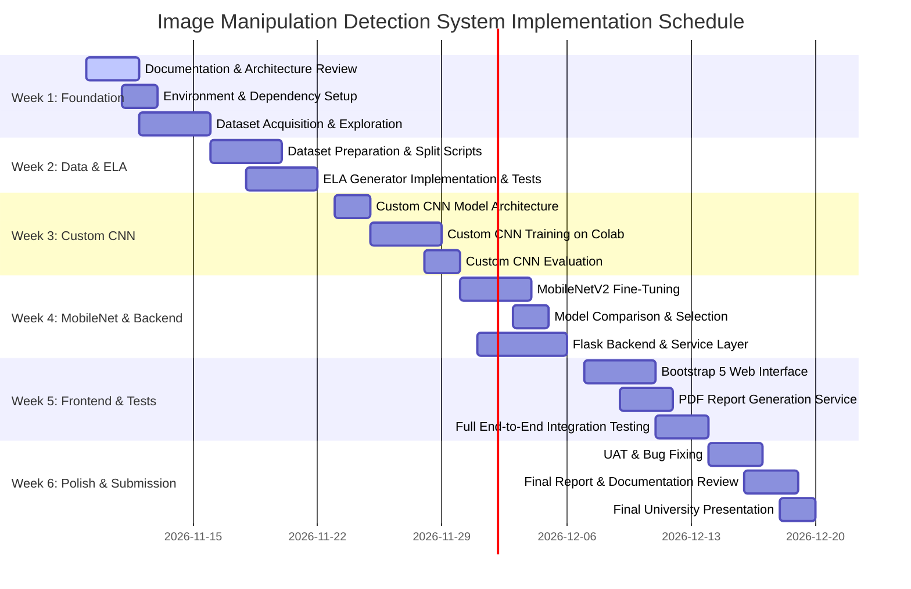

# Project Timeline & Milestone Schedule (4–6 Weeks)

## 1. High-Level 6-Week Master Schedule

---

## 2. Weekly Deliverables Breakdown

### Week 1: Project Setup, Dataset Acquisition & Exploration
- **Objectives:** Establish development repository, confirm Python 3.11 environment, inspect CASIA mirrors, and run exploratory data analysis (EDA).
- **Key Deliverable:** Verified dataset inventory and environment verification pass.

### Week 2: Dataset Preparation & Error Level Analysis (ELA)
- **Objectives:** Build `scripts/prepare_dataset.py`, generate group-aware 70/15/15 splits, and implement the core `ELAGenerator` class.
- **Key Deliverable:** Clean `data/metadata/*.csv` catalogs and verified ELA unit tests (`test_ela.py`).

### Week 3: Custom CNN Architecture & Baseline Training
- **Objectives:** Implement 4-block ConvNet in `src/models/cnn_model.py`, set up training loops with EarlyStopping and ModelCheckpointing on Google Colab.
- **Key Deliverable:** Checkpointed `cnn_model.keras` weights and training history plots.

### Week 4: MobileNetV2 Transfer Learning & Flask Backend Integration
- **Objectives:** Adapt MobileNetV2 with two-phase fine-tuning, compare models, and implement Flask application routes (`main_routes`, `detection_routes`).
- **Key Deliverable:** Checkpointed `mobilenet_model.keras` weights and functional `/analyze` backend route.

### Week 5: Frontend Interface, PDF Export & Integration Testing
- **Objectives:** Wire Bootstrap 5 UI templates (`index.html`, `result.html`), implement PDF report service with `fpdf2`, and execute pytest integration suite.
- **Key Deliverable:** Fully operational web application with live inference and downloadable PDF reports.

### Week 6: Quality Assurance, Documentation & University Submission
- **Objectives:** Conduct cross-browser testing, verify disclaimer coverage, finalize academic project reports, and prepare presentation slide decks.
- **Key Deliverable:** Final academic project submission and live demonstration.
